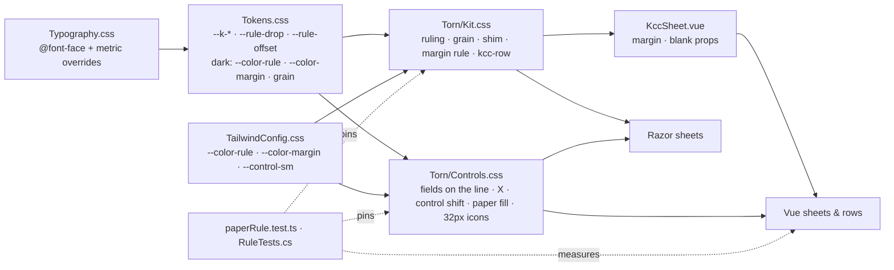

# Implementation Plan: Paper Rule Scheme

**Branch**: `003-paper-rule-scheme` | **Date**: 2026-10-19 | **Spec**: [spec.md](spec.md)

**Input**: Feature specification from `specs/003-paper-rule-scheme/spec.md`

## Summary

Put every line of text on a sheet onto the 24px rule of spec 004, in every face and size, and give the sheet the
workbench look the owner approved in `mockups/`. The brand fonts get pinned metrics, so one constant per family places
a baseline at any line height. The ruling moves to feint blue, anchored to the content box with its top 2px under the
body baseline. A kit rule shifts every other text role onto the nearest rule with `translate`, so no layout changes.
Reading sheets gain a red margin rule that leaves below 480px, every sheet gains the workbench grain, controls centre
on the caps of their line and fill with paper, icon buttons drop to 32px, and every field becomes a line to write on
with a red hand-drawn X.

## Technical Context

**Language/Version**: CSS (Tailwind 4.3.2), Vue 3 SFCs in TypeScript, Razor (.NET 10)

**Primary Dependencies**: Tailwind CSS 4 (`@theme static`), Vite, the brand fonts in `Styles/fonts/`

**Storage**: N/A

**Testing**: Vitest in `tests/KCC.ViteTests` (a new `paperRule.test.ts`, the style guards, the field component
tests), Playwright in `tests/KCC.E2ETests` (a new `RuleTests.cs` that measures baselines)

**Target Platform**: the public site, SSR plus hydration, in current Chrome, Safari and Firefox, 375px to 1440px.
CSS `mod()`, `translate`, `:has()` and container queries are in all three

**Project Type**: web application, front end of `src/KCC.Web`

**Performance Goals**: no runtime work. One pseudo-element per sheet for the grain and one per margin sheet

**Constraints**: both ramps; Razor-rendered styles in `@layer components`; `yarn build:all` only; spec 004's guard stays
green, so no raw size or vertical gap; fields keep 16px text (the iOS zoom floor) and a 36px hit area

**Scale/Scope**: 3 stylesheets and the token files, about 30 sheets marked for the margin rule, 6 FR-017 rows, 4 field
icons, 12 icon buttons, about 6 test files changed and 2 added, 2 brand docs, the `loose-leaf` skill and 2 agents

## Constitution Check

*GATE: Must pass before Phase 0 research. Re-check after Phase 1 design.*

| Principle | Holds | How |
|---|---|---|
| I. Content lives in the backoffice | Yes | No copy changes. The X is a decorative CSS glyph, not a UI string. |
| II. Loose Leaf is the only look | Yes | A kit change: tokens in `@theme static` and `Tokens.css`, classes in `@layer components`, both ramps from the approved round. `contrast.test.ts` stays green (R4), the brand steward reviews, and `docs/brand/` changes with it. |
| III. SQLite has one writer | N/A | No write path. |
| IV. Tests first, builds clean | Yes | `paperRule.test.ts` and `RuleTests.cs` are written first and fail on today's code; the field component tests change before the markup. Every `kcc-*` hook a test locates by survives; `kcc-field--noicon` is asserted only, never located by, and retires with its tests. `yarn build:all` only. |
| V. Cheap to run | Yes | No cost, no package. |
| VI. Members earn trust | N/A | No endpoint. |
| VII. Code explains itself | Yes | The ruling comment in `Kit.css` and the baseline comment at `Controls.css:490` are corrected. `docs/brand/kit.md`, `docs/brand/loose-leaf.md`, the `loose-leaf` skill and the `brand-steward` and `kit-builder` agents change in the same pull request. |

Gate 4 (no open marker): the spec has none. Ordering rule: spec 004 is on `main`; spec 002 is merged, and its blank
under-sheet stays unruled.

Post-design re-check: holds. Complexity Tracking stays empty.

## Architecture



## Approach

1. **Tests first.** Write `paperRule.test.ts` (R10) and `RuleTests.cs`. Change `InputField.test.ts`,
   `TextAreaField.test.ts`, `VariantReviews.test.ts` and `VariantCookNotes.test.ts` to the field without
   `--noicon` or an icon; add `kcc-field--noicon` to `retiredTokens.test.ts`. All fail.
2. **Metrics and tokens.** Overrides on every `@font-face` (R1). `--k-*`, `--rule-offset`, the grain tokens and the
   dark colours in `Tokens.css`; `--color-rule`, `--color-margin` and `--control-sm` in `TailwindConfig.css` (R4, R8).
3. **Sheet.** The ruling (R2), the grain (R9), the shim (R3), `kcc-sheet--blank`, `kcc-sheet--margin` and its
   container query (R5), and `kcc-row` (R6) in `Kit.css`. `KccSheet.vue` gains `margin` and `blank` props.
4. **Controls and fields.** In `Controls.css`: the control shift and paper fills (R6), 32px icon buttons (R8), fields
   as lines with the X, the textarea on the rules, the error underline (R7). `TextAreaField` snaps to whole rules.
   `InputField` loses `icon`; the four field icons leave the markup.
5. **Markup.** `margin` on the sheets in R5's list (Vue) and `kcc-sheet--margin` in `RegistrationComplete`. The six
   FR-017 rows become `kcc-row` (R6).
6. **Docs.** `docs/brand/kit.md`, `docs/brand/loose-leaf.md`, the `loose-leaf` skill, the `brand-steward` and
   `kit-builder` agents (R11).
7. **Verify.** Quickstart steps 1 to 5, the brand steward's review, then the definition of done.

## Project Structure

### Documentation (this feature)

```text
specs/003-paper-rule-scheme/
├── spec.md
├── plan.md
├── research.md
├── data-model.md
├── quickstart.md
├── contracts/paper-rule.md
├── mockups/            # approved look: workbench-look.html and its shots, README.md
└── tasks.md            # /speckit-tasks
```

### Source Code (repository root)

```text
src/KCC.Web/Features/
├── Styles/
│   ├── Typography.css              # @font-face metric overrides
│   ├── TailwindConfig.css          # --color-rule, --color-margin, --control-sm
│   └── Torn/
│       ├── Tokens.css              # --k-*, --rule-drop, --rule-offset, grain, dark colours
│       ├── Kit.css                 # ruling, grain, shim, margin rule, blank, kcc-row
│       └── Controls.css            # fields on the line, X, control shift, paper fill, icon buttons
├── Components/
│   ├── Sheet/KccSheet.vue          # margin, blank props
│   ├── Forms/                      # InputField, TextAreaField, NumberStepper
│   ├── Header/SearchForm.vue
│   ├── Recipe/SegmentedControl.vue
│   ├── RecipeDetail/               # VariantGrid, VariantToolbar
│   ├── RecipeSearch/               # RecipeSearchHeader, RecipeResultsToolbar
│   ├── RecipeWizard/               # step sheets, IngredientsStep, PhotoStep, MatchStep
│   └── VariantDetail/              # VariantIngredients, VariantInstructions, VariantNutrition, VariantCookNotes, VariantReviews
└── Pages/                          # RecipeDetail, VariantDetail (CookMode), Account/*, Login, Settings,
                                    # Account/RegistrationComplete/Index.cshtml

tests/
├── KCC.ViteTests/Features/Styles/  # paperRule.test.ts (new), retiredTokens, kitClasses, contrast
├── KCC.ViteTests/Features/**       # InputField, TextAreaField, VariantReviews, VariantCookNotes tests
└── KCC.E2ETests/Features/Chrome/RuleTests.cs   # new

docs/brand/kit.md, docs/brand/loose-leaf.md
.claude/skills/loose-leaf/SKILL.md, .claude/agents/brand-steward.md, .claude/agents/kit-builder.md
```

**Structure Decision**: a front-end change inside `src/KCC.Web/Features`, with its tests in the Vite and E2E suites
and its docs beside the brand.

## Risks

- **Controls outside rows.** The control shift assumes a control starts on a line of the sheet. One that sits in an
  `items-center` row beside something taller lands off centre. `RuleTests.cs` and quickstart step 3 find them;
  each moves into a `kcc-row`.
- **The header pad.** Its sheets are tuned to its bar. The shift and the field change can move its search; quickstart
  step 3 checks it fits at 1024px, as spec 004's FR-019 requires.
- **The shim on flex and grid items.** A role class on a flex or grid item that is not on a line of its own, such as a
  stat value, shifts too. The E2E measurement finds any that land off.
- **`mod()` and `translate`.** Both are in current browsers. An older Safari without `mod()` drops the shift and shows
  today's placement, which is still readable.
- **Scoped style IDs.** Many Vue files change: build with `yarn build:all` only.

## Complexity Tracking

None.
