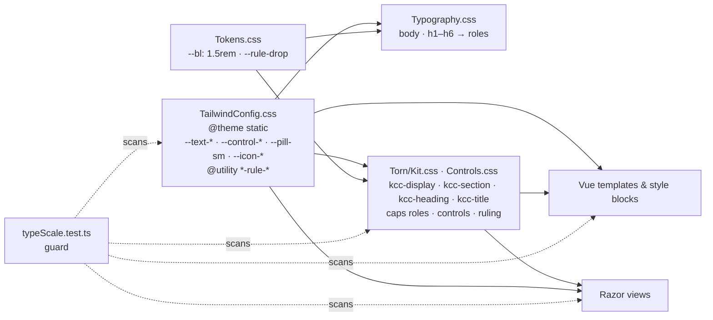

# Implementation Plan: Type Scale

**Branch**: `004-type-scale` | **Date**: 2026-10-19 | **Spec**: [spec.md](spec.md)

**Input**: Feature specification from `specs/004-type-scale/spec.md`

## Summary

Move the public site to one type scale on a 24px rule: 16px Hazelnut body, 14px Sono caps, and APCasual headings at
20, 24, 32 and 40px, as the approved look in `mockups/` shows. The first approval, 18px on a 28px rule, was built and
read as zoomed, so the owner rescaled it (Clarifications, 2026-10-19). The sizes become Tailwind `--text-*` tokens that the kit
CSS, the component style blocks and the Razor views all read. Four role classes, `kcc-display`, `kcc-section`,
`kcc-heading` and `kcc-title`, replace `kcc-h3` and `kcc-h4`, and below 768px the display role takes a phone-only
36px. Every vertical gap moves to rule utilities (`mt-rule-1`, `gap-y-rule-1.5`) that follow `--bl`, and a guard test
fails on any raw size, any `leading-*` or any raw vertical spacing that comes back.

## Technical Context

**Language/Version**: CSS (Tailwind 4.3.2), Vue 3 SFCs in TypeScript, Razor (.NET 10)

**Primary Dependencies**: Tailwind CSS 4 (`@theme static`, `@utility`), Vite, Font Awesome Pro

**Storage**: N/A

**Testing**: Vitest in `tests/KCC.ViteTests` (the guard, typography, retired tokens, kit classes, contrast and the
component tests that pin heading classes), TUnit integration and Playwright E2E for the pinned heading markup and the
sticky offset

**Target Platform**: the public site, SSR plus hydration, in current Chrome, Safari and Firefox, 375px to 1440px

**Project Type**: web application, front end of `src/KCC.Web`

**Performance Goals**: no new runtime work. CSS grows by about 25 rules and shrinks by the removed default text scale

**Constraints**: both ramps; Razor-rendered styles in `@layer components`; `yarn build:all` only; the 16px iOS field
floor (fields stay 16px); the backoffice Lit clients are out of scope (they read no kit CSS)

**Scale/Scope**: about 60 size declarations in 4 stylesheets and 3 header components, 9 Tailwind size utilities, about
110 rhythm literals and 292 spacing utilities across about 60 files, 40 heading sites, about 25 test files, 5 docs

## Constitution Check

*GATE: Must pass before Phase 0 research. Re-check after Phase 1 design.*

| Principle | Holds | How |
|---|---|---|
| I. Content lives in the backoffice | Yes | No copy, label or string changes. Class names change in Razor views and Vue templates only. |
| II. Loose Leaf is the only look | Yes | The scale is a kit change: tokens in `@theme static`, role classes in `@layer components`. Both ramps are checked (D6), the brand steward reviews (D7), and `docs/brand/` is rewritten with it. `contrast.test.ts` stays green. |
| III. SQLite has one writer | N/A | No write path. |
| IV. Tests first, builds clean | Yes | The guard (`typeScale.test.ts`) and the rewritten `typography.test.ts` are written first and fail on today's code. The heading-class tests are changed to the new names before the markup. FR-015's hook rule is amended by the owner's rename decision. `yarn build:all` only. |
| V. Cheap to run | Yes | No cost, no new package. |
| VI. Members earn trust | N/A | No endpoint. |
| VII. Code explains itself | Yes | Comments keyed to "the 24px rule" are corrected or deleted. `CLAUDE.md`, `docs/brand/loose-leaf.md`, `docs/brand/kit.md`, the `loose-leaf` skill and the `brand-steward` and `kit-builder` agents are corrected in the same change (D10). |

Gate 4 (no open marker): the spec has none. Ordering rule: one feature, one pull request; spec 003 follows it.

Post-design re-check: holds. The design adds no principle break, so Complexity Tracking stays empty.

## Architecture



## Approach

1. **Tests first.** Write `typeScale.test.ts` (research R8) and rewrite `typography.test.ts` to pin the tokens, the
   role classes and the 768px step. Add `kcc-h3` and `kcc-h4` to `retiredTokens.test.ts`. Change every test that pins
   a heading class, the readout, `leading-6`, the 24px sticky `top` or a 24/48/72 line count to the new names and
   values. All fail.
2. **Tokens.** In `TailwindConfig.css`: `--text-*: initial`, the text tokens (with the phone display) with line heights, the control,
   pill and icon tokens, and the rule utilities. In `Tokens.css`: `--bl: 1.5rem` and `--rule-drop`.
3. **Base and kit.** `Typography.css` maps body and bare headings to the roles. `Kit.css` and `Controls.css` read the
   tokens for every role, rename the heading classes, add `kcc-icon-*`, and derive the ruling offset from
   `--rule-drop`.
4. **Header.** `AppHeader`, `PadLines`, `PadCard`, `SearchForm` and the pad cards: nav items to Hazelnut body in mixed
   case (the `kcc-kick` class leaves `.pad-menu`), counts and keys to caps, glyphs to icon sizes, rhythm offsets to
   rule units.
5. **Markup sweep.** Heading classes by research R9, Tailwind sizes and icon glyphs by R7, vertical spacing by R3,
   `[72px]` section gaps to `*-rule-3`, stale rule comments corrected.
6. **Docs.** `docs/brand/loose-leaf.md` type table and rhythm lines, `docs/brand/kit.md` Type, Classes and
   Enforcement, the `loose-leaf` skill, the `brand-steward` and `kit-builder` agents, and `CLAUDE.md`'s rule size.
7. **Verify.** Quickstart steps 1 to 6, then D1 to D7 and D10.

## Project Structure

### Documentation (this feature)

```text
specs/004-type-scale/
├── spec.md
├── plan.md
├── research.md
├── data-model.md
├── quickstart.md
├── contracts/type-scale.md
├── mockups/            # approved look: rescale.html and its shots; scale.* is the replaced 18 / 28 round
└── tasks.md            # /speckit-tasks
```

### Source Code (repository root)

```text
src/KCC.Web/Features/
├── Styles/
│   ├── TailwindConfig.css          # tokens, rule utilities
│   ├── Typography.css              # base sizes, bare headings
│   └── Torn/
│       ├── Tokens.css              # --bl, --rule-drop
│       ├── Kit.css                 # role classes, icons, ruling
│       └── Controls.css            # caps roles, controls, stats, steps, checklist
├── Components/                     # Header/*, Forms/TextAreaField, Recipe/*, RecipeDetail/*, RecipeSearch/*,
│                                   # RecipeWizard/*, VariantDetail/*
├── Pages/                          # Account/*, Error, Home (Index.cshtml, Blocks/*), RecipeDetail, RecipeSearch,
│                                   # VariantDetail (CookMode, CookModeStep, StepTimer), RegistrationComplete
└── Widgets/                        # Hero/SmallHero, Stacker, Card

tests/
├── KCC.ViteTests/Features/Styles/  # typeScale.test.ts (new), typography, retiredTokens, kitClasses
├── KCC.ViteTests/Features/**       # component and page tests that pin heading classes or sizes
├── KCC.IntegrationTests/Features/Pages/Home/HomeSectionsPageTests.cs
└── KCC.E2ETests/Features/          # Chrome/PileTests.cs, Chrome/PadTests.cs, HomePage/HomePageTests.cs

docs/brand/loose-leaf.md, docs/brand/kit.md, CLAUDE.md
.claude/skills/loose-leaf/SKILL.md, .claude/agents/brand-steward.md, .claude/agents/kit-builder.md
```

**Structure Decision**: a front-end change inside `src/KCC.Web/Features`, with its tests in the three existing suites
and its docs beside the brand.

## Risks

- **Hand-tuned spots.** A few rows were tuned by hand to sit on the 28px rule (the wizard's pill and photo strip, the
  login fields, Cook Mode, the pad's search field). Each is measured again on the 24px rule (quickstart step 4).
  A pad at the new size must still fit its bar at 1024px, with the New recipe label where it fits (SC-005, FR-019).
- **Scoped style IDs.** Many Vue files change at once: build with `yarn build:all` only.
- **Spec 003 drift.** 003 still says 20 / 32. Re-clarify it to 16 / 24 before it is planned (research R10).

## Complexity Tracking

None.
