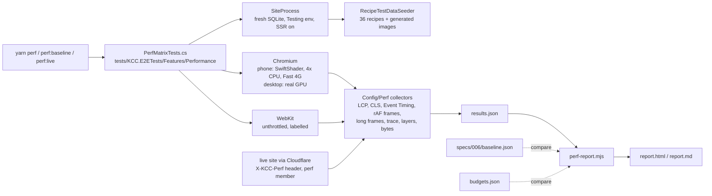
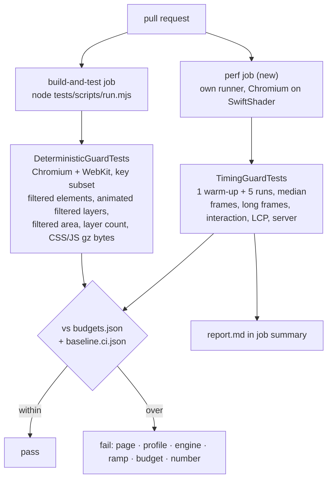
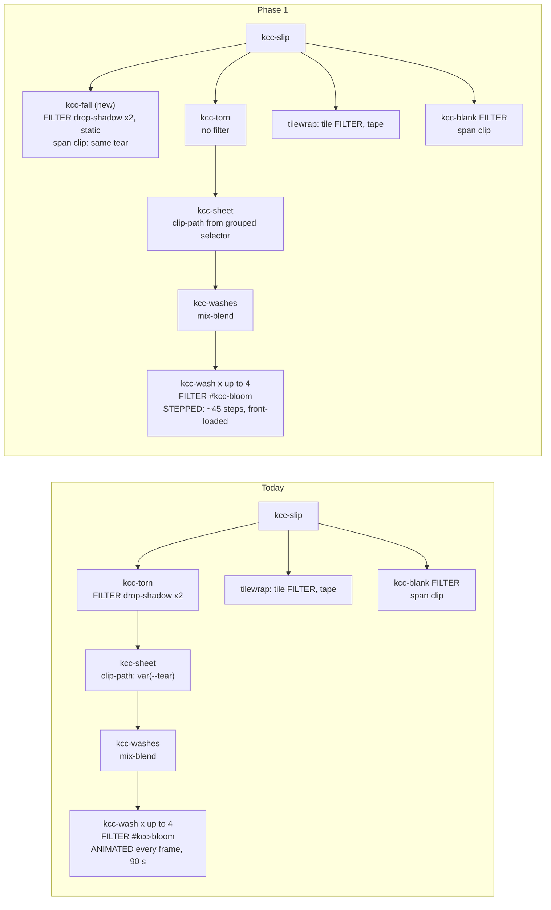
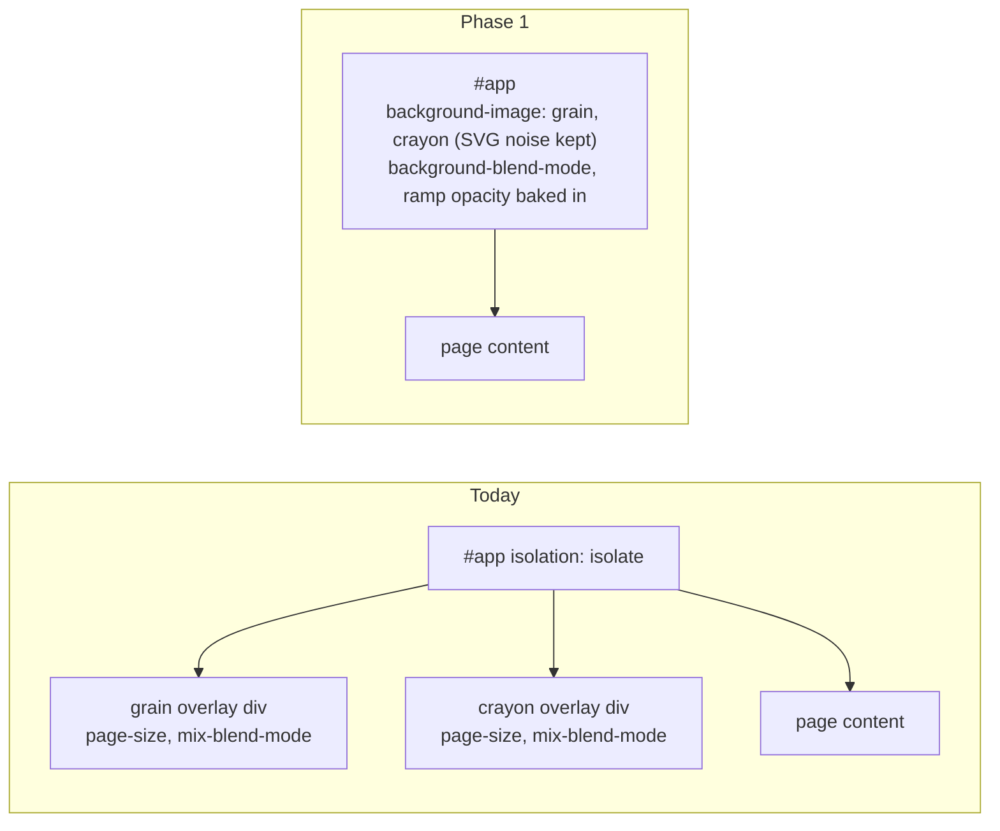
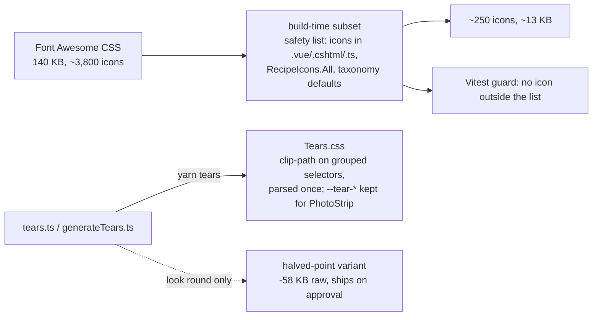
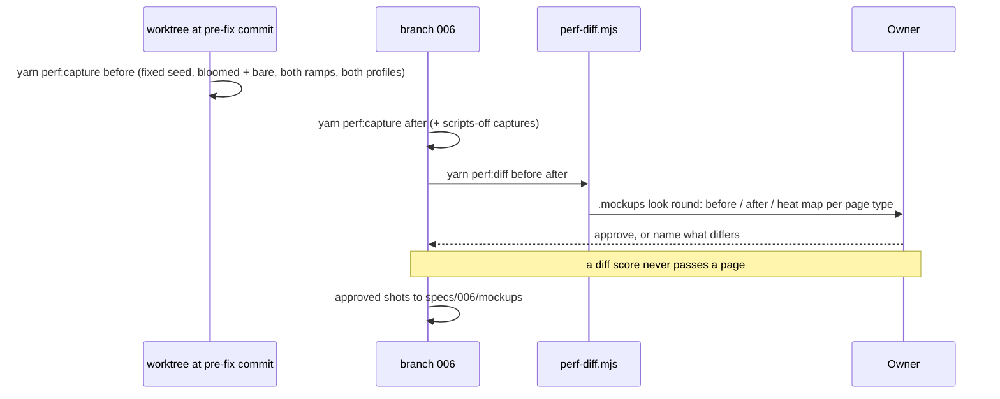
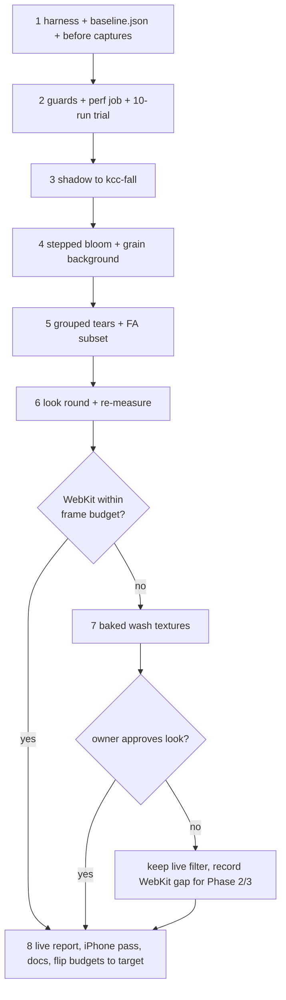

# Implementation Plan: Performance Sweep, Phase 1 - Baseline, Budgets and Paint Cost

**Branch**: `006-performance-sweep` | **Date**: 2026-10-26 | **Spec**: [spec.md](spec.md)

**Input**: Feature specification from `specs/006-performance-sweep/spec.md`

## Summary

Measure every public page before anything changes, guard the numbers in CI, then cut the GPU and compositor cost of
the Loose Leaf effects without changing the look. Profiling (research F1, F2) shows the cost is not the main thread:
the card shadows re-blur on every bloom frame and hover, the live wash filter dominates WebKit, and the five-minute
bloom keeps the GPU busy with no input. The fixes, in order: move the shadows to a static layer, step the bloom,
paint the grain as a background, apply the tear polygons once, subset Font Awesome's CSS; then re-measure, and bake
the washes only if WebKit is still over budget and the owner approves the look.

## Technical Context

**Language/Version**: C# on .NET 10 (`global.json`), TypeScript and Vue 3, CSS (Tailwind 4 plus the kit layers),
Node 24 for build scripts

**Primary Dependencies**: Umbraco 17, Vite with the SSR sidecar, TUnit with Microsoft.Playwright 1.58.0 (Chromium
and WebKit), Vitest; new dev dependencies `pixelmatch` and `pngjs`

**Storage**: SQLite, test sites only (the seeder); no schema change

**Testing**: the E2E suite (TUnit and Playwright) for the harness and the deterministic guards; Vitest in
`tests/KCC.ViteTests` for the kit and stylesheet guards; a separate `perf` CI job for the timing guards

**Target Platform**: the public site on a Raspberry Pi 5 behind Cloudflare; readers on phones (Chromium and Safari)
and desktops

**Project Type**: web application (Umbraco site with Vue SSR)

**Performance Goals**: phone usable and largest content within 2.0 s, desktop within 1.0 s; interaction within
100 ms; 95% of frames within 16.7 ms and none over 50 ms; zero layout shift after first paint (spec FR-006)

**Constraints**: the look stays the same and the owner approves every page type in a look round; SSR stays and the
scripts-off first paint matches; no recurring cost; generated tears only from `yarn tears`

**Scale/Scope**: 13 public page types x 2 ramps x 2 profiles x 2 engines x visit, image and motion states locally;
a CI key subset of 5 pages x 2 ramps x 2 engines, phone, bloomed

## Architecture

Approved in the architecture preview, round 1 (2026-10-26).

### 1. The measurement harness

What runs when you type yarn perf, and where the numbers land.



### 2. Guards on a pull request

Which checks can fail a pull request, and on what machine.



### 3. A card's layers, before and after

Why the shadow stops re-blurring: it moves to a sibling whose contents never change.



### 4. Grain and crayon

The desk texture is painted once instead of blended over the whole page every frame.



### 5. Stylesheet weight

What leaves the 317 KB stylesheet, and through which generator.



### 6. The look check

How before and after reach you, and what ships.



### 7. Order of work and the wash decision

When the washes get baked, and when they do not.



## Constitution Check

*GATE: Must pass before Phase 0 research. Re-check after Phase 1 design.*

| Principle | Check | Result |
|---|---|---|
| I. Content in the backoffice | No content or UI string changes. The seeder change runs only in Development and Testing | Pass |
| II. Loose Leaf only | Every rebuilt effect keeps the look and goes through a look round (FR-013). Both ramps are measured and captured. The kit's enforcement tests stay green; the ones a rebuild changes (research R7-R11) change with the rebuild, and `kit.md` and `CLAUDE.md` describe the new fall element in the same commit | Pass |
| III. SQLite one writer | The seeder's new recipe and media writes open one core scope and take `Constants.Locks.ContentTree` before the first read. The whole integration suite runs | Pass |
| IV. Tests first, builds clean | Each fix starts with a failing deterministic guard (a count of animated filtered layers, filtered elements, bytes). `Tears.css` comes from `yarn tears`. All six suites stay green | Pass |
| V. Cheap to run | The `perf` job uses free Actions minutes on a public repository. The Cloudflare rule is on the free plan. No major version change | Pass |
| VI. Members earn trust | The measurement member's credentials and the bypass token live in the owner's local environment. The WAF rule never touches `/umbraco` Access. The seeder answers only in Development and Testing | Pass |
| VII. Code explains itself | `kit.md`, `CLAUDE.md`, `README.md` and the runbook are corrected in the change that makes them untrue | Pass |

Ordering rule: this is Phase 1 of a stacked sweep; Phases 2 and 3 are specified from this branch after Phase 1
passes its definition of done.

Post-design re-check: the design below adds one CI job, two dev dependencies and one production line
(`performance.mark` in `Main.ts`); no principle is broken. **Pass.**

## Project Structure

### Documentation (this feature)

```text
specs/006-performance-sweep/
├── plan.md
├── research.md
├── research/profiling/      # raw profiling results behind research F1 and F2
├── data-model.md
├── quickstart.md
├── contracts/
│   ├── perf-commands.md     # yarn perf commands, variables, outputs, exit codes
│   └── budgets.md           # budgets.json, baseline files and results.json
├── baseline.json            # written by the first implementation phase (FR-005)
└── tasks.md                 # /speckit-tasks
```

### Source Code (repository root)

```text
tests/KCC.E2ETests/
├── Config/Perf/                      # profiles, page cases, metric collectors, results writer
└── Features/Performance/
    ├── DeterministicGuardTests.cs    # E2E suite: counts, area, layers, bytes, both engines
    ├── TimingGuardTests.cs           # perf job only: frames, interaction, LCP, server response
    ├── PerfMatrixTests.cs            # yarn perf: the full local matrix, writes results.json
    ├── LookCaptureTests.cs           # yarn perf:capture: PNG captures, scripts-on and scripts-off
    ├── budgets.json
    └── baseline.ci.json
tests/scripts/
├── perf-report.mjs                   # results.json to HTML and Markdown
└── perf-diff.mjs                     # pixelmatch diffs and the look round page
src/KCC.Web/
├── Features/Main.ts                  # performance.mark('kcc:hydrated')
├── Features/Styles/Torn/Kit.css      # fall element, grain background, stepped bloom
├── Features/Styles/Torn/Tokens.css
├── Features/Styles/Main.css          # Font Awesome subset import
├── Features/Torn/tears.ts, generateTears.ts   # grouped clip-path output
├── Features/Styles/Torn/Tears.css    # regenerated by yarn tears
├── Features/App.vue                  # grain and crayon overlays leave
├── Features/Components/Sheet/KccSheet.vue and every Razor slip   # render the fall element
└── Features/DevTools/RecipeSeed/     # RecipeSeedData and RecipeTestDataSeeder: 36 recipes with images
tests/KCC.ViteTests/Features/Styles/  # kit guards updated, icon subset guard added
.github/workflows/build-and-test.yml  # perf job
docs/brand/kit.md, CLAUDE.md, README.md, docs/hosting/runbook.md
```

**Structure Decision**: the harness lives in the existing E2E suite so the definition of done runs the deterministic
guards; the timing guards and the full matrix are selected by filter. The kit's CSS stays in its global layers.

## Implementation phases

1. **Harness and baseline.** Profiles, page cases, collectors, results writer, report, the `kcc:hydrated` mark, the
   seeder at 36 recipes with images, captures. Run the full matrix on the pre-fix code and commit
   `baseline.json`; capture the before look set. Verify how timing tests are kept out of the default run.
2. **Guards.** Deterministic guards in the E2E suite, `budgets.json`, `baseline.ci.json` from a CI artifact, the
   `perf` job, and the ten-run stability trial that decides which timing metrics enforce at target.
3. **Shadows to a static fall.** Failing guard first: no filter on an element whose descendants animate. Then the
   fall element in `KccSheet` and every Razor slip, kit tests and docs.
4. **Stepped bloom and grain background.** Failing guards first (animated filtered layers per second of bloom; no
   page-sized blended overlay). Then the `linear()` staircase and `#app` backgrounds.
5. **Stylesheet.** Grouped tear clip-paths from `tears.ts`, the Font Awesome subset and its guard; the halved-point
   tear variant prepared for a look round.
6. **Look round and re-measure.** Captures after, diffs, `/speckit-preview-run` round for every page type, the
   stepped bloom and the coarser tear. Re-run the matrix.
7. **Washes, stage two (conditional).** Only if WebKit is still over the frame budget: baked wash textures, a look
   round, and ship only on approval. If the owner turns the baked look down, the live filter stays and the remaining
   WebKit gap is recorded in the report for a later phase.
8. **Close-out.** Live report through Cloudflare, the owner's iPhone pass, docs, budgets flipped to target where met.

## Complexity Tracking

No violations.
