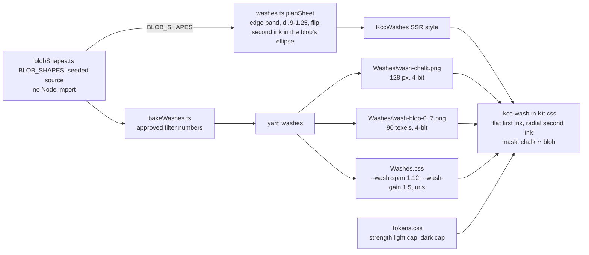

# Implementation Plan: Crayon Wash Texture

**Branch**: `007-crayon-wash-texture` | **Date**: 2026-11-04 | **Spec**: [spec.md](spec.md)

**Input**: Feature specification from `specs/007-crayon-wash-texture/spec.md`

## Summary

Bring the approved chalk wash (mockups/README.md) to the site without a filter. `yarn washes` bakes the approved
filter chain into two kinds of mask: a 128 px chalk tile (strokes, paper tooth, colour in the gaps, the one-pixel
blur) and eight silhouette masks (the first ink's faded ellipse, displaced by the lobe, ragged and stroke-end
turbulences and blurred by 4 px). The first ink becomes a flat colour that the silhouette shapes; each wash may be
mirrored. The planner moves each wash into the outer band of its quarter, grows it to 90-125% of the sheet, and
centres its second ink inside its blob's ellipse. The contrast table is re-read from the new textures, which by
estimate lowers light to its cap (.38 to .40) and dark to its cap (about .13); the owner sees the approved round at
those strengths, with the largest and smallest washes, before the bake. The 006 harness gates the result against
`main`.

## Technical Context

**Language/Version**: TypeScript and Vue 3 (planner, bake), CSS (kit layers), Node 24 (`yarn washes`), C# .NET 10
(E2E harness, unchanged)

**Primary Dependencies**: Vite with the SSR sidecar, Tailwind 4, Vitest, TUnit with Playwright (Chromium, WebKit);
no new dependency

**Storage**: N/A. Generated PNGs and CSS in `src/KCC.Web/Features/Styles/Torn/`

**Testing**: Vitest (`src/KCC.Web`, specs in `tests/KCC.ViteTests`) for the bake, planner, kit rule and contrast; the
E2E suite's deterministic guards; the 006 perf harness (`yarn perf --check`, `perf:capture`, `perf:scripts-off`)

**Target Platform**: the public site; Chromium and Safari on phones and desktops, DPR 1 and 2

**Project Type**: web application (Umbraco with Vue SSR)

**Performance Goals**: no 006 budget or guard that passes on `main` fails here, locally and in CI, in both engines,
ramps and profiles; a case whose result flips is re-run three times on both branches and judged on its median; budgets
already failing on `main` are carried (FR-007, SC-002, A12). No mid-bloom case under 50 ms on `main` goes over 50 ms
here, read from the reported `bloom_frame_max_ms`, which `--check` does not enforce (SC-003, A17)

**Constraints**: no filter on a wash (006 guard); textures under 16,000 B together (`image_bytes` ceiling 17,014 B);
AA over a two-wash stack at its peak in both ramps; scripts-off first paint equals scripts-on; bloom schedule, steps,
timing, count and depth unchanged; no hand-edited generated file

**Scale/Scope**: every sheet that blooms on 13 public page types; 9 files in `src/KCC.Web/Features`, about 11 test
files, 4 docs

## Constitution Check

*GATE: Must pass before Phase 0 research. Re-checked after Phase 1 design: unchanged.*

| Principle | Check | Status |
|---|---|---|
| I. Content in the backoffice | No content, schema or uSync change | Pass (N/A) |
| II. Loose Leaf | Kit classes and tokens only; no runtime drawing; both ramps; `contrast.test.ts` re-pinned; every enforcement test stays green; brand docs updated | Pass |
| III. SQLite | No write path | Pass (N/A) |
| IV. Tests first, builds clean | Each change starts with a failing Vitest; `yarn build:all`; generated `Washes.css` and textures only from `yarn washes`; `Tears.css` untouched | Pass |
| V. Cheap to run | No cost; no new package | Pass |
| VI. Members | No endpoint | Pass (N/A) |
| VII. Code explains itself | Retired names (`--wash-reach`, `--wash-tone`, `--wash-grain`, `wash-grain.png`) cut over everywhere at once; docs corrected in the same change | Pass |

Gates for card implement: 1 and 2 (tokens, tools) are environment checks; 3 passes; 4 holds (no marker open); 5 holds
(single phase).

## Architecture



The approach, decided in [research.md](research.md):

1. **Bake, no filter** (R1). The 006 mid-bloom guard fails on any filtered running animation.
2. **The silhouette lives in the blob mask** (R2, R3). Reference box 480 px, margin 6%, 6 px texels, the approved
   first-ink fade with no rim.
3. **The chalk lives in a tile** (R4, R5). One 1x tile serves DPR 1 and 2 (measured against the live filter in both
   engines); it turns, mirrors and blooms with its wash and keeps its CSS size on every wash.
4. **Eight silhouettes and a mirror** (R6). About 10.8 KB of textures against today's 13.7 KB; nine preloads as today.
5. **The padded box scales with the wash** (R7). `--wash-span` replaces `--wash-reach` in the padding and the pair cap.
6. **The approved placement** (R8), with every existing draw, id and arrival unchanged.
7. **Contrast re-read** (R9). Light its cap when under .42, estimated .38 to .40; dark its cap, about .13.
8. **The second ink sits inside the blob** (R2). The planner centres it within a quarter of the blob's radii from the
   blob's baked ellipse centre, so the mask keeps most of it.
9. **The blob shapes live apart from the bake** (R3). `washes.ts` ships in the client bundle, and `bakeWashes.ts`
   imports `node:zlib` and uses `Buffer`, so `BLOB_SHAPES` and its seeded source live in `blobShapes.ts`, which both
   import; a Vitest walk of `washes.ts`'s imports finds no Node module.

## Implementation order

Test first throughout (constitution IV). Each step lands its failing test, then the change.

1. **Spike: size before texture.** Planner placement and size (`washes.test.ts`), with the final padding (6% of the
   wash per side, `--wash-span` 1.12) and the final pair cap (`hypot / (s × 1.12)`), and today's textures stretched to
   the new padded box (the blob mask at `100% 100%`). `yarn build:all`, then `yarn perf` on the key cases (search-3,
   home, recipe; phone and desktop; both engines; bare, mid, bloomed) and the E2E deterministic guards, on this branch
   and against `main`, measured once before the spike in its own worktree at `origin/main`, never by switching this
   checkout (spec A20, research R10). A budget or guard that passes on `main` and fails here, after the three-run median,
   goes to the owner as an FR-003b and FR-007 conflict before step 2; `layer_area_mpx` past its limit goes to the owner
   as A18 sets.
2. **Look round at the projected strengths.** Before any bake work, `/speckit-preview-run` serves the approved round's
   live filter at about .39 light and .13 dark beside .42 and .18, with the second ink centred in the first ink's
   ellipse (R2), an unpaired reading-sheet wash of about 1,075 px and a 340 px phone card's wash of about 300 px (R3),
   in both ramps and both engines. The owner's answer routes step 3: approve, or name another strength or mark weight;
   a rejected large outline returns to the owner as A16 sets. The round goes into `mockups/`.
3. **The bake.** `bakeWashes.test.ts` and `washTextures.test.ts` to the textures contract; then `bakeWashes.ts`
   (chalk tile, silhouettes, the 4-bit encoder and its decoder in the test), `blobShapes.ts` (`BLOB_SHAPES` and its
   seeded source, no Node import), `washTextures.ts`
   (`wash-chalk.png`), `generateWashes.ts` unchanged; run `yarn washes`.
4. **The rule.** `washField.test.ts`, `paperRule.test.ts` and `grain.test.ts` to the rendering contract; then
   `Kit.css` (`.kcc-wash`, both keyframes) and `Tokens.css` (`--wash-reach` out).
5. **The mirror, the second ink and SC-007.** `washes.test.ts` (flip drawn, second ink inside its blob's ellipse,
   SC-007 over the baked shapes) and `washesImports.test.ts` (no Node module in `washes.ts`'s import graph); then
   `washes.ts`, reading `BLOB_SHAPES` from `blobShapes.ts`.
6. **Contrast.** Re-read the rendered table with the harness (research R9); `contrast.test.ts` (core alpha .34,
   texture gain, `--wash-gain`, new rows, dark cap pinned); then `Tokens.css` strengths.
7. **Docs** (research R11), and `mockups/README.md` "Still open" answered.
8. **Gate.** Quickstart 4 to 8: suites, look round with the owner (SC-001), scripts off, the full perf gate, D6, D7.

## Project Structure

### Documentation (this feature)

```text
specs/007-crayon-wash-texture/
├── spec.md
├── plan.md
├── research.md
├── data-model.md
├── quickstart.md
├── contracts/
│   ├── baked-textures.md
│   └── wash-rendering.md
├── mockups/             # approved round and its captures
├── checklists/
└── tasks.md             # /speckit-tasks
```

### Source Code (repository root)

```text
src/KCC.Web/Features/
├── Bloom/
│   ├── blobShapes.ts            # new: BLOB_SHAPES and its seeded source, no Node import (client-safe)
│   ├── bakeWashes.ts            # chalk tile, silhouettes from BLOB_SHAPES, 4-bit PNG
│   ├── washTextures.ts          # wash-chalk.png, wash-blob-<n>.png
│   ├── generateWashes.ts        # unchanged
│   └── washes.ts                # edge band, d .9-1.25, flip, o3/o4 from BLOB_SHAPES, o1/o2 and WASH_REACH_PX out
├── Styles/Torn/
│   ├── Kit.css                  # .kcc-wash, kcc-bloom, kcc-bloom-fade
│   ├── Tokens.css               # strengths; --wash-reach out
│   ├── Washes.css               # generated
│   └── Washes/                  # generated: wash-chalk.png, wash-blob-0..7.png
└── Pages/Shared/Layout.cshtml   # unchanged: preloads assets/wash-*.png

tests/KCC.ViteTests/Features/
├── Bloom/bakeWashes.test.ts, washTextures.test.ts, washes.test.ts, washesImports.test.ts, firstPaint.test.ts
└── Styles/washField.test.ts, contrast.test.ts, grain.test.ts, paperRule.test.ts, motion.test.ts, retiredTokens.test.ts
tests/KCC.ViteTests/support/retired.ts   # retired wash tokens added to RETIRED

CLAUDE.md, docs/brand/kit.md, docs/brand/loose-leaf.md, .claude/skills/loose-leaf/SKILL.md
```

**Structure Decision**: the existing web application layout; the feature changes the bloom's bake, planner and kit
rule in place.

## Definition of done

| Row | Applies | How |
|---|---|---|
| D1 | Yes | `dotnet build KitchenCommandCenter.slnx -c Release` |
| D2 | Yes | `yarn build:all`, both bundles together |
| D3 | Yes | `yarn type-check`, `yarn lint`, `yarn format` in `src/KCC.Web` |
| D4 | Yes | `node tests/scripts/run.mjs` |
| D5 | N/A by the constitution's list; `Washes.css` and textures still come only from `yarn washes`, checked by `bakeWashes.test.ts` | |
| D6 | Yes | Home, search, a recipe and sign-in in the Browser pane, both ramps |
| D7 | Yes | `brand-steward` agent |
| D8, D9 | N/A | |
| D10 | Yes | Research R11 |

Plus the feature's own gate: the owner's answer to the step-2 look round, the owner's look approval (SC-001) and the
perf gate (quickstart 7).

## Complexity Tracking

No violation.

Red team: 2026-11-04, 5 found, 5 fixed, 0 not real
