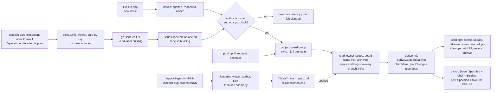

# Implementation Plan: Phone Idea Capture

**Branch**: `008-phone-idea-capture` | **Date**: 2026-11-16 | **Spec**: [spec.md](spec.md)

**Input**: Feature specification from `specs/008-phone-idea-capture/spec.md`

## Summary

The board sync learns a second kind of card: the owner's idea, an issue Th3FenrisWolf opened that carries no sync
block and whose card carries no Key. Each run reads the owner's issues and every board item, archived ones included,
then adds an open idea that is off the board, fills its blank Status, Kind and Iteration with Idea, Idea and Current,
restores it when archived, and archives it once its issue closes. A spec or bug assessment names the idea it grew
from in an `**Idea**:` line, and the sync turns that idea's card into the spec's or bug's card instead of creating a
second one. The workflow also runs on issue events from the owner, with a filter that keeps the sync's own issue
events, and everyone else's, from starting or displacing a run. `/speckit-specify #NNN` and `/speckit-bug-assess
#NNN` read the idea through a small script and write the Idea line, through two new wraps in the `kcc-ship` preset.
Building at pickup (Q2, User Story 5): `/speckit-card-implement` and `/speckit-bug-fix` look up their card's issue
through a second small script and put a `building` label on it with one `gh issue edit`; the sync reads each card issue's labels, shows a
labeled card at Building while its derived stage is Specified, and takes the label off once the derived stage passes
Specified. A `building` label event starts a run.

## Technical Context

**Language/Version**: Node 26 ES modules (`tools/project-board/*.mjs`), GitHub Actions YAML, Spec Kit command
Markdown

**Primary Dependencies**: the `gh` CLI and GitHub's GraphQL API, as today; the `specify` CLI for `reapply.sh`; no new
dependency

**Storage**: none. The board, the issues and the repository are read fresh on every run

**Testing**: Vitest, `tests/KCC.ViteTests/Tools/projectBoard.test.ts`, against the pure functions and query texts of
`derive.mjs`, the text of `project-board.yml` and the text of the two regenerated `SKILL.md` files; a manual dry run
and live checks per [quickstart.md](quickstart.md) for the GraphQL calls (Complexity Tracking)

**Target Platform**: GitHub Actions `ubuntu-latest`; the owner's machine for the commands

**Project Type**: repository tooling

**Performance Goals**: an idea reaches the board within two minutes of its issue event (SC-001, SC-006)

**Constraints**: no issue title or body in a command, a `run` step or a printed line (FR-008, research R6); the sync
fills only blanks on an idea and never changes its title, text, labels or state (FR-003, FR-004); nothing touches
another account's issue (FR-006); the sync still runs from `main`; the `building` label never stops a build and is
never added by the sync (FR-019, FR-020)

**Scale/Scope**: 35 owner issues and 34 board items today; 4 tool files, 1 workflow, 2 new wrap commands and 2
changed ones, 1 test file, `CLAUDE.md` and the constitution's Flow section

## Constitution Check

*GATE: Must pass before Phase 0 research. Re-checked after Phase 1 design, and after analyze: row IV now names one break, justified in Complexity Tracking.*

| Principle | Check | Status |
|---|---|---|
| I. Content in the backoffice | No site content or schema | Pass (N/A) |
| II. Loose Leaf | No public-site surface | Pass (N/A) |
| III. SQLite | No write path | Pass (N/A) |
| IV. Tests first, builds clean | Each derive change starts with a failing Vitest case; the workflow filter (D15, D30), the four regenerated `SKILL.md` files (D20, D29, D33), idea.mjs's first query (D21), its viewer rule (D23), the pickup stage rule (D26) and pickup.mjs's rules (D28) have failing tests first; the GraphQL calls in `sync.mjs`, `idea.mjs` and `pickup.mjs` get no unit test, a break justified in Complexity Tracking; all six suites; D1, D2, D3 (the test file is under `tests/KCC.ViteTests`), D4 and D10 apply | Pass, one justified break |
| V. Cheap to run | Issue-event runs on a public repository cost nothing; no new package | Pass |
| VI. Members earn trust | `PROJECT_BOARD_TOKEN` stays a secret; the issue and label filters sit in expressions, never in a shell step; ideas print by number only; card implement's and bug fix's `gh issue edit` names only the issue number, the repository and the label (FR-020) | Pass |
| VII. Code explains itself | `CLAUDE.md`'s Spec Kit section is corrected in the same change | Pass |

**Flow section.** The constitution says the board "holds the owner's ideas as draft cards" and that the sync "never
touches a card without a Key". This feature changes both, and adds the `building` label to how a card's stage is
read (FR-022), so FR-017 amends the Flow section as a MINOR change (2.0.0
to 2.1.0) in this pull request. Only the owner amends the constitution: the task that does it waits for the owner to
run `/speckit-constitution`, and the pull request does not ship without it.

Gates for card implement: 1 and 2 are environment checks (`specify` and `jq` for `reapply.sh` join them); 3 passes;
4 holds; 5 holds (one phase). `.github/workflows/` is a risk path, so the review stays `full`.

## Architecture



## Approach

| ID | Decision | Choice | Rejected | Why |
|---|---|---|---|---|
| D1 | Where the idea logic lives | Pure functions in `derive.mjs` (`parseIdeaLine`, `ownerIdeas`, `claimIdeas`, `planIdeas`, `ideaRefusal`, `ideaViewerError`, idea.mjs's two query texts, and claims passed into `planChanges`); reads and writes in `sync.mjs` and `idea.mjs` | A separate `ideas.mjs` module | Keeps the existing split: the test file imports `derive.mjs` and never touches the network |
| D2 | How the sync finds the owner's issues | `repository.issues(filterBy: {createdBy: owner}, states: [OPEN, CLOSED])`, 100 a page, `id number state body`, joined to items by content id | The author of each board item | An open idea that is not on the board has no item to read (research R2) |
| D3 | Seeing archived cards | `readProject` passes `archivedStates: [ARCHIVED, NOT_ARCHIVED]` and reads `isArchived` | One `Issue.projectItems` read per idea | The default read hides every archived item, and the card path needs them too (research R1) |
| D4 | A Key'd archived card that is not a takeover | Matched by its Key so no duplicate is created, and otherwise left untouched | Restore it; or keep ignoring it, which creates a duplicate | The owner archived it on purpose, and whether an archived item accepts field writes is unverified |
| D5 | Shape of the idea ops | A new `{ op: "idea", issue, add?, restore?, archive?, fields? }` op, applied after every card op | Folding ideas into `card` objects | An idea has no Key, title or body for the sync to write, so the card path's diffing does not fit it |
| D6 | Shape of a takeover | The existing `update` op with `unarchive: true` or `adopt: true`; `adopt` adds the issue with `addProjectV2ItemById` and sets `Iteration: Current` | A separate takeover op | The update path already writes the Key, title, synced block above the owner's text, fields, state and parent |
| D7 | Takeover lookup order | Key, then alias, then claimed idea. A card already matched by Key or alias claims no idea; the sync warns only when the matched item's `contentId` is not the named issue's id (D18) | Merging the card into the idea | Two existing cards cannot become one without deleting one; FR-014's "keeps that Key" points the same way |
| D8 | The Idea line | `**Idea**: [#N](url)` on its own line above `**Input**` in a spec, `- **Idea**: [#N](url)` after `- **Source**:` in an assessment; read with `^(?:- )?\*\*Idea\*\*:\s*\[?#(\d+)`, first match, from the snapshot the card already picks | Front matter or an HTML comment | Matches the header lines both files already carry and stays readable on GitHub ([contract](contracts/idea-link.md)) |
| D9 | Issue events and concurrency | `issues: types: [opened, reopened, closed]`; the workflow `concurrency.group` is `project-board-skip-<run_id>` for a filtered issue event and `project-board` otherwise; the job's `if` repeats the filter | Job-level concurrency; a second workflow file | The workflow-level group is assigned before any job `if` runs, so a filtered event in the shared group would replace a waiting run (research R4) |
| D10 | Owner identity in the workflow | `github.repository_owner`, with a test that it equals `board.json`'s `owner` | The literal login | Expressions cannot read `board.json`, and the test catches drift |
| D11 | What the sync prints for an idea | `idea #148: add, Status=Idea, Kind=Idea, Iteration=Current`, `idea #160: archive`, `idea #160: restore`; a takeover adds `takes over #148` to its update line; warnings name keys and numbers | Printing titles as cards do | A `::` line on stdout is a runner command, and anyone can title an issue (research R6) |
| D12 | How the commands read an idea | `node tools/project-board/idea.mjs <N>` prints JSON per the [contract](contracts/idea-link.md); the viewer must be the owner; author and Key are read before the body | `gh issue view` inline in each wrap | One tested refusal rule for both commands, and the body of another account's issue is never fetched (FR-011, research R7) |
| D13 | Where the `#NNN` handling survives an update | Two new wraps, `commands/speckit.specify.md` and `commands/speckit.bug.assess.md`, in the `kcc-ship` preset, version 1.2.0 with a wider description; `reapply.sh` regenerates `.composed/` and the two `SKILL.md` files, all committed | A new `kcc-ideas` preset | `kcc-ship` already stacks a wrap over another preset's (`speckit.bug.fix`), and `CLAUDE.md` names one reapply step after every update |
| D14 | What the wraps say | A section before `{CORE_TEMPLATE}`: when the input starts with `#N`, run `idea.mjs N`; on success use `title` and `body` as the description or report and write the Idea line once the file exists; on refusal print the reason and carry on with any text after `#N`, or ask for a description | Patching the core text | A wrap leaves the grilling preset's text intact under it |
| D15 | Tests for the workflow | A Vitest case reads `project-board.yml` as text and checks the `issues` trigger and that the `if` and the concurrency group carry the same author and `<!-- sync -->` filter | No workflow test; a YAML parser package | No new dependency, and the filter is the part a later edit could drop |
| D16 | Which fields count as blank | A field missing from the item or empty; only Status, Kind and Iteration are filled, each with its own write | Writing all three whenever one is blank | FR-003: a value the owner set never changes |
| D17 | Order of writes in a run | Card ops, then parent links, then idea ops | Ideas first | Claimed ideas leave the idea set during planning, so the order matters only on failure: a failing idea write then cannot hold back a spec's or bug's card, and the next run catches the idea up |
| D18 | Warning when a card matched by Key or alias names an idea | Warn only when the matched item's content is not the named issue | Warn on every match | The spec's edge case warns on "another Key"; warning on every match fires on every run after each takeover |
| D19 | Item planChanges takes when several carry one Key | The first unarchived item, else the first archived one | First in read order | Archived items are now read; an archived duplicate first in order would freeze the live card |
| D20 | Tests for the two wraps | A Vitest case reads both regenerated SKILL.md files: source preset:kcc-ship, the idea.mjs call, the Idea line form; written failing before the wraps land | A manual check only | Principle IV; same text-test pattern as D15, no new dependency |
| D21 | Testing that idea.mjs reads no body before refusing | idea.mjs's two GraphQL queries are exports of derive.mjs; a test checks the first holds no title or body field | A live check only | No issue by another account exists to check live, and FR-011's privacy clause would otherwise go unverified |
| D22 | Shape of an adopt op | type Issue, the issue's state and the owner's body as the item, so state changes only when it differs and the synced block lands above the owner's text | A bare contentId | planChanges compares item.state and item.type and merges item.body; a closed off-board idea must reopen |
| D23 | Where idea.mjs's viewer check lives | `ideaViewerError(login)` in `derive.mjs` returns the stderr message when the login is not `config.owner`, else null; idea.mjs exits non-zero with it, before any issue read | The comparison inline in idea.mjs | Every rule idea.mjs applies is then a tested derive function, which the Complexity Tracking row relies on |
| D24 | The label's name | `building`, lowercase, exported from `derive.mjs` as `BUILDING_LABEL` and compared exactly; the workflow's literal is tested equal to it | `in progress`; a set of stage labels | Names the stage it shows, needs no quoting in a `gh` argument or a workflow expression, and is the only label the sync reads |
| D25 | Where the sync reads labels | `readProject`'s `... on Issue` fragment adds `labels(first: 20) { nodes { id name } }`, mapped to `item.labels` as `[{ id, name }]`, `[]` for a draft or a pull request | A read per card issue; the owner-issue read of D2 | The board read already reaches every card's issue in one paged query, and it returns the label's id the removal needs (research R8) |
| D26 | The stage rule | `pickupStage(stage, item)` in `derive.mjs` returns `{ stage }`: `Building` when `stage` is `Specified` and the item is an `Issue` whose labels hold `building`, else `stage` unchanged; plus `unlabel: <label id>` when the label is there and `stage` is past `Specified` (Building, In review or Done; an Idea card keeps it, FR-019). `planChanges` runs it on every matched, unarchived card item before it compares fields, and compares the stage it returns. The label counts whoever added it (Q3, drafted on the recommendation) | Requiring the issue to be open, as Q2's wording has it; a stage floor applied to every stage | The sync reopens a Specified card's issue in the same update, so an open check only adds a run of flicker after a hand close; past Specified every stage already reads as Building or later |
| D27 | Taking the label off | The update op carries `unlabel: <label id>`; `apply` calls `removeLabelsFromLabelable(input: { labelableId: <issue id>, labelIds: [<label id>] })` after the op's other writes; `describeOp` adds `unlabel building`. An owner idea (D5's ops) and an archived Key'd card (D4) are never unlabeled | Leaving the label on; card implement's close-out removing it | Q2: the label comes off once a branch or pull request carries the stage, which only the sync sees; a close-out stopped by a blocker would leave it on |
| D28 | How card implement and bug fix find their card's issue | `node tools/project-board/pickup.mjs <key>`, the key being `FEATURE_DIR`'s folder name for card implement and `bug/<BUG_SLUG>` for bug fix, both forms a card's Key already takes. It checks the argument (`pickupArgumentError`), then the viewer (`ideaViewerError`, D23), reads the board's items with their Key, `isArchived` and the issue's `number` and `state`, and prints `pickupTarget(key, items)`'s answer per [contracts/building-label.md](contracts/building-label.md). Both rules are pure exports of `derive.mjs`, matching with `indexByKey` (D19) | `gh project item-list --jq` inside the wrap; the spec's Status line; an issue search | The Status line links a board filter, not a number; an item-list filter in Markdown is untested and its field naming unverified; the board is private, so the viewer rule of D23 applies here too |
| D29 | Where the pickup step lives | A `## Building at pickup` section in `.specify/presets/kcc-ship/commands/speckit.card.implement.md`, after `{CORE_TEMPLATE}` and before `## Close out through ship-branch`, adding one step between Phase 1 and Phase 2: run `pickup.mjs`, then `gh issue edit <number> --repo <repository> --add-label building` with the values from its JSON. A refusal, a non-zero exit or a failed edit is reported and the command carries on. It runs on a resumed run and on a docs-only card too. A failing text test on the regenerated `SKILL.md` comes first (the D20 pattern) | A gate on the label; `gh project item-edit` on Status; pushing the branch early | Q2 rejected the last two; the label is a view, so it never stops a build (FR-020) |
| D30 | How a label event starts a run | `issues.types` adds `labeled, unlabeled`. The job's `if` and the concurrency group run an issue event when its author is the owner and either it is `opened`, `reopened` or `closed` with no sync block, or it is `labeled` or `unlabeled` with `github.event.label.name == 'building'`; every other issue event takes its own `project-board-skip-<run_id>` group (D9). The sync's own removal starts one more run, which finds nothing to do | Waiting for the next push or the morning run; `labeled` only | Card issues carry the sync block, so today's filter skips their label events; the branch stays local for the whole build, so the next push or schedule can be a day away; a hand removal from the phone should show as fast as a hand add |
| D31 | The preset's version | `kcc-ship` goes from 1.3.0 to 1.4.0, once, for both pickup sections; its `description` and the `speckit.card.implement` and `speckit.bug.fix` entries' descriptions name the pickup label; `reapply.sh` regenerates `.composed/speckit.card.implement.md`, `.composed/speckit.bug.fix.md`, the card implement and bug fix `SKILL.md` files and `.specify/presets/.registry`, all committed | A new preset; a version per wrap | Both wraps are already this preset's, and both sections ship in one pull request |
| D32 | Who makes the label | The owner, once, before the merge, with `gh label create building` and a description (T061). The sync never makes or deletes a label | The wrap making it when the edit fails; the sync making it with `createLabel` | `gh issue edit --add-label` needs the label to exist (research R8), and the owner needs it on the phone too; one manual step keeps the sync's new writes to the removal alone |
| D33 | Bug fix's pickup step (Q4) | A `## Building at pickup` section in the existing `.specify/presets/kcc-ship/commands/speckit.bug.fix.md` wrap, after `{CORE_TEMPLATE}` and before `## Publish through ship-branch`, adding one step between Execution step 1 (the plan is confirmed and the verdict is not `invalid`) and step 2 (the remediation). It runs `pickup.mjs bug/<BUG_SLUG>` and the same `gh issue edit` as D29, with the same report-and-carry-on rule. A failing text test on the regenerated `.claude/skills/speckit-bug-fix/SKILL.md` comes first | A second bug fix wrap; leaving bug fix out (the draft before Q4) | The preset already wraps bug fix for ship-branch, and a preset holds one wrap per command; bug fix creates no branch of its own, so the step sits where the fix starts |

## Project Structure

### Documentation (this feature)

```text
specs/008-phone-idea-capture/
├── spec.md
├── plan.md
├── research.md
├── data-model.md
├── contracts/idea-link.md
├── contracts/building-label.md
├── quickstart.md
└── checklists/requirements.md
```

### Source Code (repository root)

```text
tools/project-board/
├── derive.mjs        # Idea line, owner ideas, claims, idea ops, refusal and viewer rules, idea.mjs's queries; planChanges takes claims; BUILDING_LABEL, pickupStage, pickupArgumentError, pickupTarget
├── sync.mjs          # reads owner issues, archived items and card issue labels; applies idea ops, unarchive, adopt, unlabel; describe()
├── idea.mjs          # new: the command-side read
└── pickup.mjs        # new: card implement's and bug fix's read of their card's issue number
.github/workflows/project-board.yml
.specify/presets/kcc-ship/
├── preset.yml        # 1.4.0, two new wraps
├── commands/speckit.specify.md       # new
├── commands/speckit.bug.assess.md    # new
├── commands/speckit.card.implement.md   # Building at pickup section
├── commands/speckit.bug.fix.md          # Building at pickup section
└── .composed/                        # regenerated by reapply.sh
.specify/presets/.registry            # rewritten by reapply.sh
.claude/skills/speckit-specify/SKILL.md      # regenerated
.claude/skills/speckit-bug-assess/SKILL.md   # regenerated
.claude/skills/speckit-card-implement/SKILL.md   # regenerated
.claude/skills/speckit-bug-fix/SKILL.md          # regenerated
tests/KCC.ViteTests/Tools/projectBoard.test.ts
CLAUDE.md             # Spec Kit section: issue and label events, owner ideas, Idea line, the two wraps, the building label
.specify/memory/constitution.md   # Flow section, by the owner through /speckit-constitution (FR-017)
```

**Structure Decision**: the feature stays inside the board tooling and the Spec Kit preset. No site code changes.

## Build order

1. **Tests first.** In `projectBoard.test.ts`: the Idea line in both forms; the owner-idea rule (author, sync block,
   Key'd item); each idea action of [data-model.md](data-model.md); blanks only; closed off-board ideas stay off;
   claims (winner by key, ineligible ideas, a card matched by Key on the idea it names warns nothing, one matched on
   another item warns, per D18); several items with one Key, the first unarchived one matched (D19); takeovers on the
   board, archived and off the board, the adopt op carrying type Issue, the issue's state and the owner's body (D22);
   a Key'd archived card makes no create; the refusal rule; the viewer rule (D23); idea.mjs's first query holds no
   title or body (D21); no title in any described op; the workflow text and the owner equality. All fail.
2. **derive.mjs** until they pass.
3. **sync.mjs**: the two reads, the idea ops, `unarchiveProjectV2Item`, `archiveProjectV2Item`, adopt, `describe`,
   warnings. Dry run per [quickstart.md](quickstart.md). Then the workflow.
4. **idea.mjs**: the viewer rule, the first query, the refusal, then the second query. Live reads per
   [quickstart.md](quickstart.md).
5. **Preset**: a failing test first that reads both regenerated `SKILL.md` files for `source: preset:kcc-ship`, the
   `idea.mjs` call and the Idea line form (D20); then the two wraps, `preset.yml`, `reapply.sh` until it passes.
6. **Building at pickup**, after step 5: failing tests for `pickupStage` and for `planChanges` on labeled items, then
   `derive.mjs`; the label read and the removal in `sync.mjs`; the workflow test extended for label events, then the
   workflow; failing tests for `pickupArgumentError` and `pickupTarget`, then `derive.mjs`, then `pickup.mjs`; a
   failing text test on the card implement `SKILL.md`, then its wrap section; a failing text test on the bug fix
   `SKILL.md`, then its wrap section; `preset.yml` and `reapply.sh`; a dry run
   and the read-only `pickup.mjs` checks of [quickstart.md](quickstart.md). The owner made the label (D32).
7. **Docs**: `CLAUDE.md`; then the owner runs `/speckit-constitution` for the Flow section.

## Complexity Tracking

| Violation | Why Needed | Simpler Alternative Rejected Because |
|---|---|---|
| Principle IV: the GraphQL calls in `sync.mjs` (the owner-issue read, the archived-item read, the card issue labels, add, archive, unarchive, adopt and the label removal), in `idea.mjs` (the viewer read, then the two issue reads in order) and in `pickup.mjs` (the viewer read, then the board read) change behaviour with no failing unit test first | They only carry data between GitHub and `derive.mjs`. Every rule they apply is a tested derive function: `ownerIdeas`, `claimIdeas`, `planIdeas`, `planChanges`, `pickupStage`, `ideaRefusal`, `ideaViewerError` (D23), `pickupArgumentError`, `pickupTarget`, and the first query's text (D21). The calls themselves are checked by the dry run against the live board and the read-only `idea.mjs` and `pickup.mjs` reads of [quickstart.md](quickstart.md) | A stubbed `gh` or GraphQL layer: it would test the stub's shape, not GitHub's schema, and the test file never touches the network today (D1) |

## Decided with the owner

- **Q1** (product, owner, 2026-11-16): yes, the owner turns off the board's built-in "Item closed" workflow before the
  merge, so a reopened idea returns with the Status it had (research R5). [quickstart.md](quickstart.md) lists it as
  an owner step. No code depends on it; only SC-006's Status check does.
- **Q2** (product, owner, 2026-11-16): yes, Building at pickup is part of 008. `/speckit-card-implement` adds a
  `building` label to the card's issue with one `gh issue edit` when it starts, and pushes nothing; the sync shows a
  card issue carrying it as Building while the derived stage is Specified, and takes it off once a pushed branch or a
  pull request carries the stage; the owner can set it by hand. Rejected: setting Status with `gh project item-edit`,
  which the sync reverts, and pushing early, which breaks the recompose rule and
  `.claude/hooks/require-recomposed-branch.sh`. D24 to D33 carry it out.
- **Q3** (product, owner, 2026-11-16): the label counts whoever added it (D26), so no read of who added it is planned.
- **Q4** (product, owner, 2026-11-16): bug fix adds the label too, through a pickup section in the kcc-ship bug fix
  wrap, test-first and regenerated by `reapply.sh` (D33).
