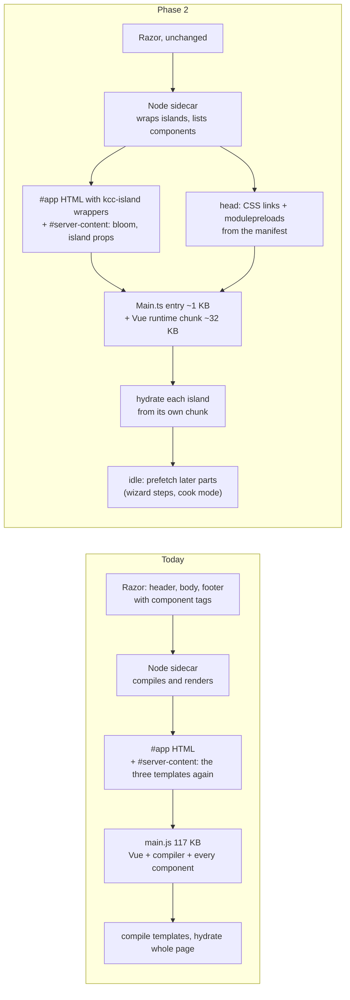
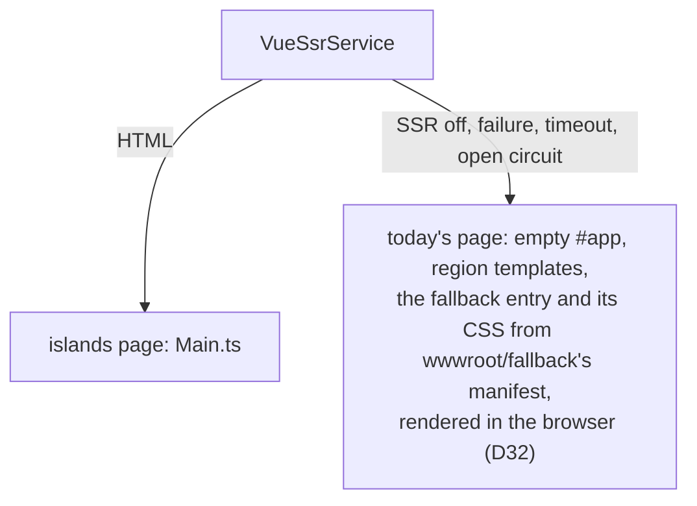
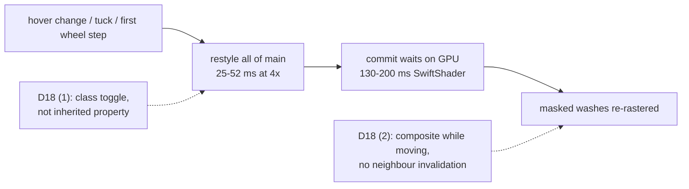

# Implementation Plan: Performance Sweep, Phase 2 - Script Weight, Hydration and Interactivity

**Branch**: `009-script-hydration-cost` | **Date**: 2026-11-17 | **Spec**: [spec.md](spec.md)

**Input**: Feature specification from `specs/009-script-hydration-cost/spec.md`

## Summary

Two findings set this plan (research F1-F4, on `c1827268`):

- **Script.** Every page fetches one 117 KB chunk: Vue with its template compiler, because the browser compiles the
  header, body and footer from a second copy of their HTML, plus every component of every page. A scratch islands
  build puts every page at 41-58 KB gzipped once only the interactive components a page renders load, the compiler
  and the second copy leave, and the wizard's later steps and cook mode load after the page is usable.
- **Interaction and frames.** The phone's 136-248 ms "first input" is not the first input and not script. The first
  pointer move answers within 16 ms. The slow entries are the hover changes during the first wheel steps and the
  card lifts. Each has no input delay and no handler time. Its whole duration is the next frame: a 25-52 ms restyle of
  all of `<main>`, because the tuck writes an inherited custom property there, then a 130-200 ms wait while the
  software GPU re-rasterises masked washes. Hiding the washes takes the worst entry from 232-248 ms to 48-112 ms, and
  search-3's long frames from 5 to 0.

So Phase 2 does two jobs. **Islands** meet the weight and usable-time budgets: the sidecar marks each interactive
global component, the browser hydrates only those, each from its own preloaded chunk, and a fallback bundle keeps
today's in-browser rendering for a page the sidecar could not render. **Render work** meets the interaction and frame
budgets: take the tuck's restyle off `<main>`'s descendants, then stop the tuck, the lift and the first scroll from
re-rasterising masked washes. Each change is measured, captured before and after, and kept only when the look holds or
the owner approves it. If no look-preserving change reaches 100 ms, the owner decided (Q1, 2026-11-17): every
look-preserving fix is tried first; a wash change still needed goes to the owner in a look round on the affected pages
(before and after, both ramps, phone and desktop, with the measured gain of each change), and ships only on the
owner's approval. With that round the owner answers one question (C2, 2026-11-17): approve the wash change, or keep
the look and carry the phone Chromium gap, in which case "C2 fallback amendment" below is applied.

## Technical Context

**Language/Version**: TypeScript and Vue 3.5 (`<script setup>`), C# on .NET 10, CSS (Tailwind 4 and the kit layers),
Node 26 (Dockerfile and CI)

**Primary Dependencies**: Vite 8 (Rolldown), `@vitejs/plugin-vue`, Vite.AspNetCore (`IViteManifest`), the Express
SSR sidecar (`Features/Ssr/Server.js`), Microsoft.Playwright 1.64.1 and TUnit for the harness, Vitest. No new
package.

**Storage**: none. No schema, content or uSync change.

**Testing**: Vitest in `tests/KCC.ViteTests` for the island registry, the payload, the wizard split and the CSS
audit; the E2E suite for the deterministic guards and every behaviour test unchanged; the `perf` job for the timing
guards; the local matrix (`pnpm perf --check`) for every budget at target.

**Target Platform**: the public site on the Pi behind Cloudflare; Chromium and Safari on phones, desktop browsers.

**Project Type**: web application (Umbraco site with Vue SSR).

**Performance Goals**: at most 61,440 B (60 KB) gzipped of script before usable on every page type; usable within
2.0 s on the phone and 1.0 s on desktop and no later than baseline; every interaction within 100 ms; 95% of frames
within 16.7 ms and none over 50 ms; zero layout shift after first paint, recipe search's appends included.

**Constraints**: the look does not change unless the owner approves a page in a look round (FR-018); the scripts-off
first paint matches (FR-014); no behaviour changes (FR-012); washes keep the visit clock (FR-017); no Phase 1 metric
gets worse, layer counts included (FR-010).

**Scale/Scope**: 12 page types in Phase 1's matrix (232 cases); 17 global components, 10 of them islands; 83 Vue files.

## Approach

| # | Decision | Choice | Rejected | Why |
|---|---|---|---|---|
| D1 | How a page becomes interactive | Islands: the sidecar wraps each interactive global component Razor places, and the browser hydrates each from its own chunk | Whole-page hydration without the compiler (precompiled regions) | Razor writes the markup around the components, so no build sees it; islands need no Razor change (research Decisions) |
| D2 | The island's container | `<kcc-island data-island="N">`, `display: contents` in the kit's base layer, with an audit of child, sibling and structural selectors that can meet an island root | Hydrating an element in place among its siblings through Vue's static-vnode adoption | Vue mounts into a container; adoption leans on Vue internals that change between minors |
| D3 | Which global components are islands | Every `*.Component.vue` unless it declares `defineOptions({ serverOnly: true })`; `AppFooter`, `Card`, `UnderlineLink`, `KccWashes`, `Breadcrumbs`, `ResourceString` and `SmallHero` declare it | Marking islands opt-in | A missed mark then costs bytes, never a control (FR-012, FR-015) |
| D4 | What an island placed by Razor may take | Props only; the sidecar fails the render, naming the component, on slot content or a function | Serialising Razor slot content into the island | No island takes Razor content today; `Card`, the one that does, has a CSS-only drawer and is server-only |
| D5 | The client's Vue build | Runtime-only (`vue` resolves to the package default) with `__VUE_OPTIONS_API__` and the production devtools and mismatch-detail flags off; the SSR build and the dev server keep `vue.esm-bundler.js` | Keeping the compiler | 20.8 KB of compiler plus the template copy; no component uses the Options API |
| D6 | A page the sidecar could not render | A third build, `vite build --mode fallback`, of today's whole-app entry with the compiler into `wwwroot/fallback/`; `Layout.cshtml` links it, and `#server-content` carries the region templates, only when the sidecar returned no HTML | Dropping the in-browser rescue; one build with two Vue copies | Keeps today's degraded behaviour and the integration suite's `RenderedPage` (SSR off); two copies in one graph split reactivity |
| D7 | The page payload | `#server-content` keeps its id and carries `{ isPreview, bloom: { seed, page, pageWashes }, islands: [{ name, props, keys }] }`, no region HTML | Props in per-element data attributes | One JSON parse, no attribute escaping; E2E's `Washes.SeedAsync` reads `bloom.seed` unchanged |
| D8 | The bloom across islands | One client bloom provided to every island; it replays each island's server-claimed `keys`, and `markHydrated(pageWashes)` takes the server's page-wash count | Re-claiming keys and counting washes on the client | Server-only washes never run on the client, so a client count would shift every late start (FR-017) |
| D9 | When islands hydrate | Every island on the page at load, in parallel; `kcc:hydrated` after the last mounts | Hydrating on visibility or idle | "Usable" means every control shown on load works; deferral is for parts not shown (FR-013) |
| D10 | How chunks and styles reach the head | The sidecar returns the rendered global components and islands; `Layout.cshtml` writes a stylesheet link for each one's CSS closure and a `modulepreload` for each island's chunk closure, from `IViteManifest` | Vite.AspNetCore's entry link alone; CSS injected at import time | The scripts-off first paint needs every style in the head (FR-014); preloads remove the chunk round trips on Fast 4G |
| D11 | The header | An island like any other, preloaded | A static import of the entry | One rule for every island; with the preload it costs no extra round trip |
| D12 | A global component used inside a `.vue` file | Imported explicitly (`Breadcrumbs` in the recipe, variant and search views); a Vitest scan fails on an unimported component tag | Registering globals on the client | Registering pulls every global into the entry |
| D13 | The wizard's later steps | `Components/RecipeWizard/wizardSteps.ts` globs `./*Step.vue` minus `StartStep`, `BasicsStep` and `VariantStep` into async components; `RecipeWizard.vue` takes each with `const XStep = laterStep('XStep')`; prefetched at idle after usable; a pending sheet if a reader outruns the chunk | A map of step to loader; a `defineAsyncComponent` line per step | A new `*Step.vue` is split by its file name alone (see "The recipe wizard") |
| D14 | Cook mode | A later part: `CookMode.vue` through `defineAsyncComponent`, prefetched at idle | Eager | Variant detail measures 57.7 KB eager, too close to 60 KB to hold |
| D15 | First-load and later script | `js_first_load_gz_bytes`: level-9 gzip of the same-origin scripts whose resource entry starts before `kcc:hydrated`, a `modulepreload`ed chunk included; `js_later_gz_bytes`: the rest of the measured visit's same-origin script; `js_gz_bytes` stays the visit total | Vite's reported sizes; counting every origin | Same rule and counter as Phase 1's `js_gz_bytes`; deterministic, because prefetch starts after the mark. The scripts Cloudflare adds in production are Phase 3's (spec Assumptions) |
| D16 | What CI enforces for weight and usable time | `js_first_load_gz_bytes` at target 61,440 B and `js_gz_bytes` at target 117,266 B in `DeterministicGuardTests` (key subset, both engines); `hydrated_ms` at target (2,000 / 1,000 ms) scaled by the runner factor, plus its baseline entry, in `TimingGuardTests` | Keeping `hydrated_ms` at baseline only | FR-020 sets targets; the runner factor is how Phase 1 made `hydrated_ms` steady on CI (R4) |
| D17 | Stand-ins for the interaction and frame budgets on CI (FR-021) | Deterministic probes in `DeterministicGuardTests`, Chromium: `islands_hydrated` (no increase), `restyled_on_tuck` and `restyled_on_hover` (the `UpdateLayoutTree` element count of one scripted tuck and one scripted lift), and `wash_raster_on_interaction` (paint invalidations that reach a `.kcc-wash` during the same two moves) | Timing budgets at target on CI | Phase 1's trial found no timing metric steady at target; these counts measure the two causes F3 found |
| D18 | How the interaction and frame budgets are met | Render work in order: (1) the tuck stops writing an inherited property on `<main>` and toggles a class the sticky neighbours read; (2) the lift, the tuck and the first scroll stop re-rasterising masked washes, by compositing what moves only while it moves and keeping a lift from invalidating its neighbours; (3) re-measure. A candidate that changes a wash's look goes to a look round | Script or hydration changes alone | No script runs in the slow frames (F3); a resting layer would raise Phase 1's exact layer count (FR-010) |
| D19 | Layout shift while search appends | Record the shifting nodes first (`layout-shift` sources); then, after `kcc:hydrated`, the browser holds the space the next page needs while more results remain, below the screen, sized from the server's total and the grid's columns; the server renders nothing new, so first paint and the scripts-off page stay as today. A test covers a short first page whose footer is on screen at hydration | The server drawing the reserved band; anchoring scroll to the footer | The owner's C3 answer (2026-11-17): a server band shows blank at first paint and stays with scripts off; anchoring moves the reader's view when a page lands (FR-012) |
| D20 | Before and after | "Before" is `c1827268`: the full matrix as `specs/009-script-hydration-cost/before.json` and the capture set `before`, from a worktree at that commit; "after" is the branch head, `after.json` and `after` | Comparing with Phase 1's `baseline.json` | FR-001 names `main` at the start of this phase |
| D21 | The E2E hydration wait | `Hydration.WaitAsync` waits for the `kcc:hydrated` mark instead of `#app.__vue_app__`, and `BloomTests`' two mount checks (`RecordBeforeMount`'s `mounted`, asserted false as `MountedBefore`, and the scripts-off check) read the mark too | Setting `__vue_app__` on `#app` by hand | `#app` holds no app once islands mount; the mark is the documented "usable" |
| D22 | Where island code lives | `src/KCC.Web/Features/Islands/`: the client registry and hydrator, the SSR wrapper and the payload types; `GlobalComponents.ts` keeps the naming rule | Spreading it through `Main.ts` and `Ssr/` | One folder per feature, as the repository does |
| D23 | Raster and trace probes | `restyled_on_*` and `wash_raster_on_interaction` read a CDP trace with `devtools.timeline` and `disabled-by-default-devtools.timeline.invalidationTracking`; three fresh boots must read the same counts before they are enforced | Counting with `MutationObserver` | Style and paint invalidation are engine work a DOM observer cannot see |
| D24 | Where the 20 KB proof and the stability trials run before the pull request | Locally, against the same guard classes CI runs (`DeterministicGuardTests`, `TimingGuardTests`): the 20 KB import as an uncommitted scratch edit that is removed after the run; three local runs of both guard classes and three of `pnpm perf --check` on unchanged code (the owner's decision of 2026-11-19, amending C1); no branch is pushed for it; the CI runs follow on the open pull request | A throwaway draft pull request or pushed branch | The owner's C1 answer (2026-11-17); implementation tasks never commit, push or open a pull request, and a pushed branch writes live board cards and issues |
| D25 | "Before" values of the metrics this phase adds | Copy the branch's measurement harness (`tests/KCC.E2ETests/`, `tests/scripts/`) into the `c1827268` worktree, run the matrix there, and add only the new metric keys to `before.json` | Leaving the new metrics without a before value | FR-001 asks for each metric before and after; `c1827268` already writes the `kcc:hydrated` mark the split reads |
| D26 | CI baselines of the metrics this phase adds | At T009, a guard run in baseline mode (`KCC_PERF_MODE=baseline`, which `GuardRun.Conclude` writes with `merge: true, mergeMetrics: true`) adds the new keys to `baseline.ci.json` and keeps every existing value; `islands_hydrated` stays report-only until T064 and T065 re-baseline it after the islands land | Registering the metrics at baseline with no CI baseline value; enforcing `islands_hydrated` from T009 | A baseline-mode budget with no baseline value cannot be enforced; islands raise the count from 1 to one per island, so "no increase" from today's value fails in Phase 5 by design |
| D27 | What "no worse than baseline" reads for FR-007, FR-009 and FR-010 | `specs/009-script-hydration-cost/before.json` (`c1827268`), through the report's before column with each budget's local margin; `specs/006-performance-sweep/baseline.json` is never rewritten on this branch, and `pnpm perf:baseline` runs only in the "before" worktree | Re-baselining 006's `baseline.json` from this branch; comparing with 006's baseline | FR-001 names `main` at the start of this phase; `pnpm perf --check` keeps enforcing against 006's baseline, so the branch must not move it |
| D28 | How the tuck tells the sticky neighbours | `useTuckOnScroll` writes `--pad-h` on `<main>` only on measure and resize; the tuck and the show toggle `.is-tucked` on `<main>`; each sticky neighbour (`StackerBlock.cshtml`, `RecipeSearchView.Component.vue`'s aside, `Stacker.Component.vue`'s cards and sentinels) adds `var(--pad-h)` to its top only under `main:not(.is-tucked)`; the root's `scroll-padding-top` is written as today | Keeping `--pad-offset` and writing it on every tuck | An inherited property written on `<main>` restyles every descendant (F3, 25-52 ms); a class change invalidates only the elements a selector names |
| D29 | Which pages CI's byte guard reads | `DeterministicGuardTests` measures `js_first_load_gz_bytes` and `js_gz_bytes` over the key subset (`Cases.KeySubset`: home, search-3, recipe, variant-cook, account) plus create-recipe and add-variant, both engines | The key subset alone | The wizard pages are the closest to 61,440 B (62.9-63.1 KB eager) and are not in the key subset |
| D30 | The pending state of a later part | The part's own `KccSheet` with its tear, empty, `aria-busy="true"`; no text and no dictionary key | A spinner; a "Loading" string | The sheet is already the step's look, so nothing new enters the brand or the dictionary; T082 opens it in both ramps |
| D31 | The shared CPU lock | `mkdir` of `/Users/twinright/Repos/Personal/Kitchen-Command-Center/.git/kcc-cpu.lock`, an `owner` file (session, pid, what, start time); poll up to 5 minutes, then exit non-zero; clear a lock whose owner pid is dead with an atomic `mv` to `$LOCK.stale.$$` then `rm -rf`, and retry `mkdir`; the `EXIT` trap is set only after the lock is taken | Falling through to the run after the polls; `rm -rf` of a stale lock in place | A run that falls through or a racing clear lets two timing runs share the CPU, and a trap set before acquiring deletes another session's lock |
| D32 | The fallback page's CSS | In production, `Layout.cshtml` links the fallback entry's script and a stylesheet for its CSS closure, both read from `wwwroot/fallback/.vite/manifest.json` through a reader in `Features/Islands/`; in development it links `Features/Fallback.ts` from the dev server | Vite.AspNetCore's tag helpers alone | Vite.AspNetCore reads only `wwwroot/.vite/manifest.json`, so the fallback build's extracted CSS (the header's style block) would reach no page |
| D34 | The wizard's first steps (amends D13 at implement) | The step glob excludes only `./StartStep.vue`: `BasicsStep` and `VariantStep` are later parts too, prefetched at idle ahead of the other steps; the step a wizard opens on (with import disabled, the flow's first typing step) is resolved before the island mounts | Keeping `BasicsStep` and `VariantStep` static | With every other later part moved (`ReadingState`, `SubmittedSheet`, `PhotoStrip`, `LeaveConfirm`, `photoEncoding`), add-variant still read 61,512 B first-load against 61,440; with this it reads 56,806 and create-recipe 56,571. A new `<Name>Step.vue` still joins by its name and one `laterStep` line |
| D35 | A later part the server rendered as an island's first view | An island component may declare `beforeHydrate(props)`; `hydrate.ts` awaits it before hydrating, and `RecipeWizard` uses it to resolve the step it opens on | Keeping the opening steps static; letting hydration wait inside the async component | Hydrating over an unresolved async step leaves its inputs dead or shows the pending sheet over the server's HTML, and the mark comes late |
| D36 | Focus on a step change | The watcher blurs a focused control inside the leaving step before the patch and focuses the new heading after the next painted frame | Focusing in the frame that swaps the step | Removing a focused element and focusing the new heading each forced a style recalc of about 500 elements (22 ms each) inside the press |
| D33 | Style blocks in a server-only component | A Vitest scan fails on a `<style>` block in a `serverOnly` component; none has one today | Linking it in development too | In development the client never imports a server-only component, so its CSS lives only in `<style data-ssr-styles>`, which `Main.ts` removes after hydration |

## Architecture

### 1. A rendered page, before and after



### 2. When the sidecar has no HTML



### 3. Where the phone's slow frames go



## Script split

**Entry.** `Features/Main.ts` shrinks to the bootstrap: the API config, one bloom, the island hydrator, the
`kcc:hydrated` mark, the heartbeat and the idle prefetch. `App.vue`, the eager glob and the compiler leave the
client graph; they stay in the SSR entry and the fallback build. Vue's runtime and what every island shares
(`bloomContext.ts`, `washes.ts`, `KccSheet`) form one shared chunk, about 32 KB.

**Per page.** `GlobalComponents.ts` exports two registries over the same `*.Component.vue` glob: an eager one for the
sidecar and the fallback build, and a lazy one for the client, where each component is a dynamic entry and so its own
chunk. A page fetches the entry, the shared chunk, and the chunks of the islands it renders, all preloaded from the
head. Rolldown places code two islands share in a shared chunk on its own.

| Page | Islands on load | First-load script (scratch build) |
|---|---|---|
| error, status-404 | header | 41.4 KB |
| home | header, stacker | 42.5 KB |
| sign-in, account | header, login or account | 44.1-44.5 KB |
| settings | header, settings | 47.6 KB |
| recipe | header, recipe detail | 52.2 KB |
| search-1, search-3 | header, search | 52.9 KB |
| variant-cook | header, variant detail | 57.7 KB eager, less cook mode (D14) |
| create-recipe, add-variant | header, the view | 62.9-63.1 KB eager, less the later steps: an estimated 8-10 KB, measured in implementation step 5 |

If a wizard page is still over 60 KB after step 5, `ReadingState`, `SubmittedSheet` and `PhotoStrip`, which no
first step shows, join the later parts by the same `defineAsyncComponent` rule as cook mode.

**Shared components.** A server-only global component renders on the sidecar and ships no script. A component an
island imports rides in that island's chunk or a shared one. Only the header has style blocks today; `cssCodeSplit`
stays on, and every component's CSS is linked from the head by D10 whether its script is fetched or not.

**The template compiler and the second copy.** The island build has no compiler, and on a rendered page
`#server-content` carries no region HTML (D5, D7). Both remain only on the fallback path (D6), as FR-016 allows,
since FR-012 to FR-015 hold there unchanged.

**Interactive blocks the owner places (FR-015).** A block's component is found by its tag wherever Razor puts it:
the sidecar wraps it if it is an island and the browser hydrates it on any page, with no code change for a new
placement. `Stacker` stays an island; `Card` and the rich text block are server-only, and the card's drawer is CSS.
A new interactive block is a new `*.Component.vue` that takes props only.

## The recipe wizard

The pages `CreateRecipeView` and `AddVariantView` are islands. Inside, `RecipeWizard.vue` imports the shell, the flow
and the steps a wizard can open on (`StartStep`, `BasicsStep`, `VariantStep`) statically. Every other
`Components/RecipeWizard/*Step.vue` is a later part (D13): `wizardSteps.ts` finds them with one
`import.meta.glob(['./*Step.vue', '!./StartStep.vue', '!./BasicsStep.vue', '!./VariantStep.vue'])`, wraps each in
`defineAsyncComponent` with the pending sheet, and exports `laterStep(name)` and `prefetchLaterSteps()`.
`prefetchLaterSteps()` runs in idle time after `kcc:hydrated` and calls each component's loader, so a step is resolved
before a reader reaches it and renders in the same tick. `next()` changes `wizard.step` at once; the progress bar
answers the tap even if the chunk is late, and the step's sheet shows pending until it arrives.

**How a new wizard step plugs in.** Nothing in the split is per step beyond one line:

1. **File**: `src/KCC.Web/Features/Components/RecipeWizard/<Name>Step.vue`. The `Step.vue` ending is what puts it in
   the later-part glob; any other component it imports rides in its chunk.
2. **Registration**: in `RecipeWizard.vue`, `const <Name>Step = laterStep('<Name>Step')` beside the others, and its
   `<<Name>Step v-else-if="wizard.step === '<id>'" ...>` block in the template, as every step has. Never a static
   `import ... from './<Name>Step.vue'`: `wizardSteps.test.ts` fails on one, because a static import would pull the
   step into the first load.
3. **Flow**: its id in `StepId`, its place in `TYPING_STEPS` and its rule in `PROCEED_RULES` in `recipeWizardFlow.ts`,
   which is the step's behaviour, not the split.
4. **Nothing else**: no change to `vite.config.ts`, `GlobalComponents.ts`, `Main.ts`, the island registry, the
   budgets or the baselines. A step that can be the first one shown, which none of 010's is, joins the static imports
   and the glob's exclusions.

**Overlap with 010.** Feature 010 adds a Details step between instructions and review, for typed and imported recipes,
and a "suggested by the reader" mark. 009 builds none of it. 010 adds `DetailsStep.vue` and `DetailsSummary.vue` in
`Components/RecipeWizard/`. After 009 lands:

- `import DetailsStep from './DetailsStep.vue'` in `RecipeWizard.vue` becomes
  `const DetailsStep = laterStep('DetailsStep')`, and the template block is unchanged. DetailsStep is a later part.
- `import DetailsSummary from './DetailsSummary.vue'` in `ReviewStep.vue` stays as it is. It rides in ReviewStep's
  chunk, and its name does not end in `Step.vue`.
- 010's bytes then count toward later script, not first load, except what it adds to the flow and the shell; the
  visit total stays under 117,266 B. 009's edit to `RecipeWizard.vue` is the same one-line swap for each later step,
  so whichever branch merges second makes the same swap for DetailsStep.

## Behaviour, first paint and the visit clock

- **No behaviour change (FR-012).** Every control's code is the code it is today; only how it is loaded moves. The
  E2E suites run unchanged in what they check; the readiness wait and `BloomTests`' two mount checks change their
  signal to the mark (D21). Infinite scroll, the tuck, the pad cards, recently viewed, cook mode, the wizard and every
  form are covered there. D18's render changes keep each effect's timing and end state, and a test names the tuck's
  class toggle; the Vitest and integration tests that pin `--pad-offset` in markup move to D28's rule.
- **Search's reserved space (D19).** The browser adds it after `kcc:hydrated`, below the screen, so the server's HTML,
  the first paint and the scripts-off page are today's.
- **Scripts-off first paint (FR-014).** The sidecar's HTML is what it renders today plus the `kcc-island` wrappers,
  which lay out as nothing; every component's CSS is linked in the head (D10). `pnpm perf:scripts-off` runs on every
  page type with Phase 1's rule.
- **The visit clock (FR-017).** Blooms are CSS from `--wash-elapsed`, written by the server, so the first paint is the
  same whenever hydration ends. The server's page-wash count and each island's claimed keys reach the client (D8), so
  late starts and wash ids match today's for the same visit time. `firstPaint.test.ts` and `BloomTests` hold it.

## Guards (FR-020 to FR-022)

| Metric | Where | Mode on CI | Mode locally (`pnpm perf --check`) |
|---|---|---|---|
| `js_first_load_gz_bytes` | `DeterministicGuardTests`, key subset plus create-recipe and add-variant (D29), both engines | target 61,440 B | target 61,440 B, every page |
| `js_gz_bytes` (visit total) | same | target 117,266 B | target 117,266 B |
| `js_later_gz_bytes` | same | report-only | report-only |
| `islands_hydrated` | same | report-only until T065 re-baselines it, then baseline, no increase (D26) | same |
| `restyled_on_tuck`, `restyled_on_hover` | same, Chromium only | target from the fix's result, after three identical boots | same |
| `wash_raster_on_interaction` | same, Chromium only | target from the fix's result | same |
| `hydrated_ms` | `TimingGuardTests` | target 2,000 / 1,000 ms x runner factor, and baseline with `ciMargin` | target and baseline |
| `interaction_ms_max`, `frames_within_16_7_pct`, `long_frames`, `frame_p95_ms` | `TimingGuardTests` | report-only (Phase 1's trial) | target once three of three pass |
| `cls`, `cls_scroll` | `TimingGuardTests` | report-only | target 0 |

A failure names page, profile, engine, ramp, budget and number, as Phase 1's do. The trace stand-ins read a CDP trace,
so they run on Chromium only; WebKit reports each as a named gap, and its interaction and frame numbers stay in the
report (FR-009). Live numbers never fail CI.

Stability and the proof run locally, against the guard classes CI runs (D24, the owner's C1 answer, amended
2026-11-19): three local runs of `DeterministicGuardTests` and `TimingGuardTests` and three of `pnpm perf --check` on
unchanged code pass every time before a guard flips (FR-022), and three fresh boots read the same probe counts (D23).
A run that overlaps a machine sleep is discarded and run again. The proof (SC-007) imports about 20 KB of gzipped
script into the entry as an uncommitted scratch edit, runs the guard classes, records the failure in research and
removes the edit. No branch is pushed for either; CI runs the same classes on the pull request.

### C2 fallback amendment (apply only on the owner's keep-the-look answer)

The owner answered C2 (2026-11-17): when a wash change still looks necessary after every look-preserving fix, T056
sends one look round and the owner answers one question, approve the wash change or keep the look and carry the phone
Chromium gap. On "keep the look", T056a applies the text below to `spec.md`, keeps the phone Chromium interaction
and frame budgets in `budgets.json` at baseline mode (scoped entries that T066's flip to target does not reach; the
report reads them against `before.json`, D27), and records the gap in research.md
with its measured numbers (worst interaction, share within 16.7 ms, long frames, per page and visit). On "approve",
nothing here is applied.

- **FR-004**, from "on both profiles in Chromium" to the end replaced: "on the desktop profile in Chromium and WebKit. On the phone profile in
  Chromium, no interaction MAY be slower than its baseline in `specs/009-script-hydration-cost/before.json`; the gap
  to 100 ms is recorded with its measured numbers in research.md and goes to Phase 3 or a later phase. The first
  input after a page becomes usable and the first use of each control are included."
- **FR-005**, appended: "On the phone profile in Chromium, the share of frames within 16.7 ms and the long frames MUST
  NOT get worse than their baseline in `before.json`; the gap to the target is recorded and goes to Phase 3 or a later
  phase."
- **SC-001**, from "on the throttled phone and the desktop profile in Chromium" to the end replaced: "on the desktop profile in Chromium and WebKit; on the throttled phone in
  Chromium, no measured interaction is slower than its baseline, and the recorded gap to 100 ms goes to Phase 3 or a
  later phase."
- **SC-002**, appended: "On the throttled phone in Chromium, frames are no worse than their baseline, and the recorded
  gap goes to Phase 3 or a later phase; the zero layout shift holds there as everywhere."
- **Phase table**: one sentence directly under the table, not a row and not a change to row 3's Covers cell: "Phase 2
  carries a phone Chromium interaction and frame gap, recorded in `specs/009-script-hydration-cost/research.md`, to
  Phase 3 or a later phase." A row would change what the board sync reads from the table (`parsePhases`), and Phase 3
  covers the server, so the gap is not claimed as Phase 3's.

## Look and scripts-off checks (FR-018, FR-014)

1. From a worktree at `c1827268`: `pnpm build:all`, a Release build, `pnpm perf:capture before`.
2. At each step that can change pixels (islands, D18's changes, D19), on the branch: `pnpm perf:capture after`, then
   `pnpm perf:diff before after`. Every page type, both ramps, both profiles, bare and bloomed.
3. A page the diff flags goes to the owner in a `/speckit-preview-run` look round, and does not ship until approved.
   A page with no flag needs no round. Approved shots go to `specs/009-script-hydration-cost/mockups/`.
4. `pnpm perf:scripts-off` on every page type, light signed out and the saved ramp for the member, with Phase 1's
   residue rule.

## Docs (FR-023)

- `CLAUDE.md`: "Vue SFC `<style>` blocks" (CSS links per rendered component from the manifest; the fallback build;
  `pnpm build:all` builds three bundles), a short "Islands" section (the `serverOnly` rule, props only, explicit
  imports, later parts and the wizard step rule), and the budgets.
- `docs/brand/kit.md`: the hydration lines in the SSR section (`kcc-island`, the payload, the fallback) and
  "Build both bundles together" becoming all three.
- `specs/006-performance-sweep/contracts/perf-commands.md` and `contracts/budgets.md`: the new metrics, the target
  modes and the runner-scaled target; `README.md` and `docs/hosting/runbook.md` where they name the bundle.

## Constitution Check

*GATE: Must pass before Phase 0 research. Re-check after Phase 1 design.*

| Principle | Check | Result |
|---|---|---|
| I. Content in the backoffice | No content, dictionary or uSync change. No content view changes: `Layout.cshtml` gains the head links and the entry-or-fallback switch, and `StackerBlock.cshtml` reads the tuck class (D28); any block the owner places renders as today (FR-015) | Pass |
| II. Loose Leaf only | No new look. `kcc-island` is layout-neutral; D18 keeps each effect's look, and anything the diff flags goes to a look round. Kit tests, the contrast table and the no-drawing-script rule stay green (FR-019). Both ramps captured | Pass |
| III. SQLite one writer | No write path changes | Pass |
| IV. Tests first, builds clean | Each change starts with a failing test: the payload and registry tests, the explicit-import scan, `wizardSteps.test.ts`, the first-load byte guard at target, the restyle and raster probes. `pnpm build:all` builds all three bundles together | Pass |
| V. Cheap to run | No package, no paid service; the `perf` job keeps its free runner | Pass |
| VI. Members earn trust | The anti-forgery token still reaches every form through `#api-config` before any island mounts | Pass |
| VII. Code explains itself | `CLAUDE.md`, `kit.md`, the 006 contracts, `README.md` and the runbook change in the commit that makes them untrue | Pass |

Ordering rule: Phase 1 (006) passed its definition of done and is merged. This branch starts from `main`. Phase 3
is specified from this branch after this phase passes its definition of done.

Post-design re-check: one new folder (`Features/Islands/`), one new build mode, one new custom element, no new
dependency, store or public endpoint. **Pass.**

## Project Structure

### Documentation (this feature)

```text
specs/009-script-hydration-cost/
├── plan.md
├── research.md
├── research/probes/          # FR-003 probe, ablation runner, trace slicer, summary of every run
├── contracts/islands.md      # global components, server output, payload, fallback, hydration, later parts
├── quickstart.md
├── before.json, after.json   # full matrix at c1827268 and at the branch head (implementation)
├── mockups/                  # approved look-round shots, if any page is flagged
└── tasks.md                  # /speckit-tasks
```

### Source Code (repository root)

```text
src/KCC.Web/
├── vite.config.ts                       # runtime-only client, flags, fallback mode, three outputs
├── package.json                         # build:all builds client, ssr and fallback
├── Features/Main.ts                     # island bootstrap
├── Features/Fallback.ts                 # today's whole-app entry, fallback build only
├── Features/GlobalComponents.ts         # eager and lazy registries over *.Component.vue
├── Features/Islands/                    # registry, hydrator, SSR wrapper, payload types
├── Features/Ssr/Server.Entry.ts, Server.js        # islands, components, pageWashes in /render
├── Features/Ssr/VueSsrService.cs, Models/Common/SsrResult.cs, SsrHtmlContent.cs   # payload, fallback path
├── Features/Pages/Shared/Layout.cshtml  # CSS links, modulepreloads, entry or fallback
├── Features/Bloom/bloomContext.ts       # key replay, markHydrated(pageWashes)
├── Features/Components/RecipeWizard/wizardSteps.ts, RecipeWizard.vue
├── Features/Pages/VariantDetail/VariantDetailView.Component.vue   # cook mode later
├── Features/Components/Header/useTuckOnScroll.ts and the sticky neighbours   # D18 (1)
├── Features/Styles/Torn/Kit.css, Styles/Layout.css, Styles/Main.css          # kcc-island, selector audit, D18 (2)
├── Features/Components/RecipeSearch/, Pages/RecipeSearch/                    # D19
└── the seven server-only components     # defineOptions({ serverOnly: true })
tests/KCC.ViteTests/Features/Islands/    # registry, payload, explicit imports, kcc-island selector audit
tests/KCC.ViteTests/Features/Components/RecipeWizard/wizardSteps.test.ts
tests/KCC.E2ETests/Config/Perf/          # first-load bytes, islands, restyle and raster probes
tests/KCC.E2ETests/Config/Hydration.cs, Features/Chrome/BloomTests.cs   # D21
tests/KCC.E2ETests/Features/Performance/budgets.json, baseline.ci.json
.github/workflows/build-and-test.yml     # the fallback build in the bundle steps
.gitignore                               # **/wwwroot/fallback
Dockerfile                               # the build:all comment names three bundles (no instruction changes)
CLAUDE.md, docs/brand/kit.md, specs/006-performance-sweep/contracts/, README.md, docs/hosting/runbook.md
```

**Structure Decision**: the island code is one feature folder beside `Ssr/` and `Bloom/`; the probes join Phase 1's
harness in the E2E project, so the definition of done runs them.

## Implementation phases

1. **Before.** Full matrix at `c1827268` into `before.json` and the `before` capture set. Re-trace sign-in's long
   frames (research F4); if they reproduce, trace them with `research/probes/` before step 6.
2. **Measurement.** `js_first_load_gz_bytes`, `js_later_gz_bytes`, `islands_hydrated`, the restyle and raster probes,
   and the three-boot determinism check. Guards at baseline first.
3. **Islands.** Failing tests first (payload, registry, explicit imports, selector audit), then the SSR wrapper, the
   payload, the bootstrap, the CSS links and preloads, the explicit imports, the `serverOnly` marks, and the E2E
   hydration waits.
4. **Fallback build.** The third build, the layout switch, and a test that a page with the sidecar down still renders.
5. **Later parts.** `wizardSteps.ts` and its test; cook mode; idle prefetch; the pending sheet.
6. **Render work (D18).** The tuck's class toggle; then the raster candidates, each measured with the probe and the
   matrix; captures and diff after each.
7. **Search layout shift (D19).** Shift sources, then the space the browser reserves below the screen after usable.
8. **Guards to target**, the three-run trial, the 20 KB proof, `after.json`, the look round if any page is flagged, the
   owner's iPhone pass (FR-011), docs.

## Wizard and shared component loading — summary for 010

- **Entry**: `Features/Main.ts` is a small bootstrap. It hydrates each `<kcc-island>` the server rendered, from that
  island's own chunk, and marks `kcc:hydrated` when the last one mounts.
- **Per-page split**: every `*.Component.vue` is a lazy chunk. A page fetches only the islands it renders, all
  preloaded from the head. The wizard pages (`CreateRecipeView`, `AddVariantView`) are islands.
- **Shared components**: a `*.Component.vue` is an island unless it declares `defineOptions({ serverOnly: true })`. An
  island Razor places takes props only. Inside `.vue` files every component is imported explicitly; nothing resolves
  globally in the browser.
- **Lazy wizard steps**: every `Components/RecipeWizard/*Step.vue` except `StartStep`, `BasicsStep` and `VariantStep`
  loads after the page is usable, found by one glob in `wizardSteps.ts` and prefetched at idle.
- **New step**: add `<Name>Step.vue` in `Components/RecipeWizard/`. In `RecipeWizard.vue` write
  `const <Name>Step = laterStep('<Name>Step')`, never a static import, plus its `v-else-if` block. Then add its flow
  entries in `recipeWizardFlow.ts`. Nothing else changes. For 010: `DetailsStep` takes `laterStep('DetailsStep')`, and
  `DetailsSummary` stays a static import in `ReviewStep.vue`, riding in that step's chunk.
- **New shared component**: a new `*.Component.vue` is an island by naming alone. A static one adds `serverOnly`. An
  island's style block needs nothing: in production the head links every rendered component's CSS, and in development
  the island's own import brings it. A `serverOnly` component takes no style block (D33): in development its CSS would
  vanish when `Main.ts` removes `<style data-ssr-styles>`; its styles go in the kit's `@layer components` CSS.

## Complexity Tracking

No violations.
